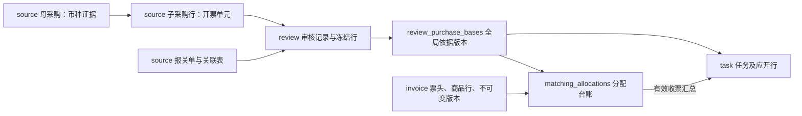

# 当前表设计与字段字典

核对日期：2026-10-16。范围：当前工作区代码（含未提交改动）、实体定义与 `0001`—`0016` 迁移。**27 张业务表、430 个字段，另有 1 张迁移版本表**。本次未连接业务数据库，不能据此认定目标库已执行迁移或已有实际数据。

本文解释现有字段；对应实体已补齐中文 `comment`，数据库备注由新增 `0010`—`0015` 迁移写入。设计决策以[数据库设计](../architecture/database.md)为准；本文列出的是当前实现字段，不把旧六表、八表历史 SQL 当作当前结构。

## 1. 先看业务主线

最核心的业务对象是**子采购行**：NS 提供来源，财务冻结应开依据，任务跟进应开数量与金额，发票通过分配台账计入收票进度。报关单用于组织审核，一条子采购行即使关联多张报关单，也不能重复生成有效应开量。

图中箭头表示业务依赖或数据流，不表示全部存在数据库外键。跨模块保存 ID，由服务校验；下文明确列出的“数据库外键”才是物理约束。

| 模块     | 表数 | 管什么                                       |
| -------- | ---: | -------------------------------------------- |
| source   |   10 | NS 主数据、母子采购、报关、原始来源与关联    |
| review   |    3 | 报关审核历史、冻结行、全局开票依据版本       |
| task     |    6 | 开票任务、收票进度、合同、群配置、通知和事件 |
| invoice  |    4 | 发票原始来源、当前票头与行、历史版本         |
| matching |    1 | 发票行与子采购行的分配及复核台账             |
| sync     |    3 | 同步记录与增量水位业务待接入；已有账号绑定已实现 |

## 2. 字段阅读约定

- `id` 是本地数据库主键，`ns_internal_id` 是 NS 身份，`order_no` / `invoice_no` 是业务单号，三者不能混用。来源身份按账套隔离；当前结构没有旧六表的 `tenant_id`。
- 所有业务表都有 `created_at`、`updated_at`；时间为 UTC `DATETIME(6)`，业务日期为 `DATE`。`updated_at` 由 DAO 写入。只有 `sync_cursors` 不使用自增 `id`。
- `DECIMAL(p,s)` 表示总共 p 位、小数 s 位。数量一般为 `(26,8)`，来源及分配金额 `(24,6)`，发票金额 `(18,2)`，单价 `(24,8)`；接口以十进制字符串传输。
- `NULL` 表示缺失或不适用，不等于 0。表中“可空”只表示数据库允许，不表示业务提交时一定允许缺失。
- “默认”列列的是数据库默认值；“—”表示没有数据库默认值，不代表写入 NULL；“自动生成”列由数据库计算，不能手工维护。
- `*_normalized` 是搜索比对副本；`*_sha256` 是内容摘要，供去重、版本检测，不是业务编号。
- 下文类型按 MySQL 编译；布尔字段显示 `BOOL`。字段数量包含主键、公共时间列和生成列。

## 3. 全部表与字段

| 表名                                                            | 中文用途               | 字段数 |
| --------------------------------------------------------------- | ---------------------- | -----: |
| [source_suppliers](#source_suppliers)                           | 供应商                 |      8 |
| [source_companies](#source_companies)                           | 采购公司与申报主体目录 |      8 |
| [source_raw_records](#source_raw_records)                       | NS 原始数据            |      9 |
| [source_parent_orders](#source_parent_orders)                   | 母采购单               |     19 |
| [source_parent_order_lines](#source_parent_order_lines)         | 母采购明细             |     15 |
| [source_purchase_orders](#source_purchase_orders)               | 子采购单               |     23 |
| [source_purchase_order_lines](#source_purchase_order_lines)     | 子采购明细／开票单元   |     20 |
| [source_customs_declarations](#source_customs_declarations)     | 报关单                 |     17 |
| [source_customs_lines](#source_customs_lines)                   | 报关明细               |     21 |
| [source_customs_purchase_links](#source_customs_purchase_links) | 报关与子采购关联       |     12 |
| [review_records](#review_records)                               | 报关审核记录           |     13 |
| [review_lines](#review_lines)                                   | 审核冻结明细           |     18 |
| [review_purchase_bases](#review_purchase_bases)                 | 全局开票依据版本       |     23 |
| [task_supplier_groups](#task_supplier_groups)                   | 供应商默认企微群       |     11 |
| [task_tasks](#task_tasks)                                       | 开票任务               |     15 |
| [task_lines](#task_lines)                                       | 任务应开与收票进度     |     22 |
| [task_documents](#task_documents)                               | 合同归档记录           |     14 |
| [task_notifications](#task_notifications)                       | 开票通知版本           |     16 |
| [task_events](#task_events)                                     | 任务事件历史           |     13 |
| [invoice_raw_records](#invoice_raw_records)                     | 发票原始来源           |      9 |
| [invoice_headers](#invoice_headers)                             | 发票当前票头           |     28 |
| [invoice_items](#invoice_items)                                 | 发票逻辑商品行         |     17 |
| [invoice_versions](#invoice_versions)                           | 发票不可变业务版本     |     13 |
| [matching_allocations](#matching_allocations)                   | 发票与采购行分配台账   |     35 |
| [sync_runs](#sync_runs)                                         | 同步运行记录           |     17 |
| [sync_cursors](#sync_cursors)                                   | 增量同步水位           |      6 |
| [sync_lemon_bindings](#sync_lemon_bindings) | 柠檬云已有账号绑定状态 | 8 |

### source_suppliers｜供应商

一行一个 NS 供应商。比对发票销售方，当前没有税号字段。

结构依据：[表定义](../../backend/modules/source/entity/supplier.py)；业务说明：[source 模块](../../backend/modules/source/README.md)。

| 字段              | MySQL 类型        | 可空 | 默认                 | 中文含义                                                    |
| ----------------- | ----------------- | ---- | -------------------- | ----------------------------------------------------------- |
| `id`              | `BIGINT UNSIGNED` | 否   | 自增                 | 本地自增主键；与 NS 内部 ID、单号分开保存                   |
| `ns_account`      | `VARCHAR(100)`    | 否   | —                    | NS 账套标识，用于隔离正式、沙箱等来源                       |
| `ns_internal_id`  | `VARCHAR(190)`    | 否   | —                    | NS 来源身份；与账套组合识别记录。公司身份可能带记录类型前缀 |
| `name`            | `VARCHAR(255)`    | 否   | —                    | 名称原文                                                    |
| `name_normalized` | `VARCHAR(255)`    | 否   | —                    | 规范化后的名称，用于搜索、比对，不代替原名展示              |
| `is_active`       | `BOOL`            | 否   | 1                    | 当前是否有效；停用保留历史记录，不物理删除                  |
| `created_at`      | `DATETIME(6)`     | 否   | CURRENT_TIMESTAMP(6) | 本地记录创建时间，UTC                                       |
| `updated_at`      | `DATETIME(6)`     | 否   | CURRENT_TIMESTAMP(6) | 本地记录最后更新时间，UTC；由 DAO 更新                      |

**关联与约束**

- 主键：`id`。
- 唯一约束 `uq_source_supplier_ns`：`(ns_account, ns_internal_id)`。
- 查询索引 `ix_source_supplier_name`：`(ns_account, name_normalized)`。

### source_companies｜采购公司与申报主体目录

一行一个来源公司身份。采购公司与申报主体使用不同来源身份，不能仅因名称相同合并。

结构依据：[表定义](../../backend/modules/source/entity/company.py)；业务说明：[source 模块](../../backend/modules/source/README.md)。

| 字段              | MySQL 类型        | 可空 | 默认                 | 中文含义                                                    |
| ----------------- | ----------------- | ---- | -------------------- | ----------------------------------------------------------- |
| `id`              | `BIGINT UNSIGNED` | 否   | 自增                 | 本地自增主键；与 NS 内部 ID、单号分开保存                   |
| `ns_account`      | `VARCHAR(100)`    | 否   | —                    | NS 账套标识，用于隔离正式、沙箱等来源                       |
| `ns_internal_id`  | `VARCHAR(190)`    | 否   | —                    | NS 来源身份；与账套组合识别记录。公司身份可能带记录类型前缀 |
| `name`            | `VARCHAR(255)`    | 否   | —                    | 名称原文                                                    |
| `name_normalized` | `VARCHAR(255)`    | 否   | —                    | 规范化后的名称，用于搜索、比对，不代替原名展示              |
| `is_active`       | `BOOL`            | 否   | 1                    | 当前是否有效；停用保留历史记录，不物理删除                  |
| `created_at`      | `DATETIME(6)`     | 否   | CURRENT_TIMESTAMP(6) | 本地记录创建时间，UTC                                       |
| `updated_at`      | `DATETIME(6)`     | 否   | CURRENT_TIMESTAMP(6) | 本地记录最后更新时间，UTC；由 DAO 更新                      |

**关联与约束**

- 主键：`id`。
- 唯一约束 `uq_source_company_ns`：`(ns_account, ns_internal_id)`。

### source_raw_records｜NS 原始数据

一行一个来源身份的一版原始内容；内容变化追加记录，保留追溯证据。

结构依据：[表定义](../../backend/modules/source/entity/raw_record.py)；业务说明：[source 模块](../../backend/modules/source/README.md)。

| 字段             | MySQL 类型        | 可空 | 默认                 | 中文含义                                                    |
| ---------------- | ----------------- | ---- | -------------------- | ----------------------------------------------------------- |
| `id`             | `BIGINT UNSIGNED` | 否   | 自增                 | 本地自增主键；与 NS 内部 ID、单号分开保存                   |
| `ns_account`     | `VARCHAR(100)`    | 否   | —                    | NS 账套标识，用于隔离正式、沙箱等来源                       |
| `record_type`    | `VARCHAR(100)`    | 否   | —                    | NS 原始记录类型；关联依据使用 relation_evidence             |
| `ns_internal_id` | `VARCHAR(190)`    | 否   | —                    | NS 来源身份；与账套组合识别记录。公司身份可能带记录类型前缀 |
| `payload`        | `JSON`            | 否   | —                    | 未经业务投影的来源正文或关联依据 JSON，供追溯               |
| `payload_sha256` | `CHAR(64)`        | 否   | —                    | 原始内容 SHA-256；相同来源身份及摘要不重复存储              |
| `fetched_at`     | `DATETIME(6)`     | 否   | —                    | 取得该原始数据的时间，UTC                                   |
| `created_at`     | `DATETIME(6)`     | 否   | CURRENT_TIMESTAMP(6) | 本地记录创建时间，UTC                                       |
| `updated_at`     | `DATETIME(6)`     | 否   | CURRENT_TIMESTAMP(6) | 本地记录最后更新时间，UTC；由 DAO 更新                      |

**关联与约束**

- 主键：`id`。
- 唯一约束 `uq_source_raw_content`：`(ns_account, record_type, ns_internal_id, payload_sha256)`。

### source_parent_orders｜母采购单

一行一张 NS 母采购单。当前重点同步单头、币种、汇率及原始引用，为子采购继承币种。

结构依据：[表定义](../../backend/modules/source/entity/parent_order.py)；业务说明：[source 模块](../../backend/modules/source/README.md)。

| 字段                   | MySQL 类型        | 可空 | 默认                 | 中文含义                                                                                  |
| ---------------------- | ----------------- | ---- | -------------------- | ----------------------------------------------------------------------------------------- |
| `id`                   | `BIGINT UNSIGNED` | 否   | 自增                 | 本地自增主键；与 NS 内部 ID、单号分开保存                                                 |
| `ns_account`           | `VARCHAR(100)`    | 否   | —                    | NS 账套标识，用于隔离正式、沙箱等来源                                                     |
| `ns_internal_id`       | `VARCHAR(190)`    | 否   | —                    | NS 来源身份；与账套组合识别记录。公司身份可能带记录类型前缀                               |
| `ns_record_type`       | `VARCHAR(100)`    | 否   | —                    | NS 单据记录类型，母采购为 purchaseOrder                                                   |
| `order_no`             | `VARCHAR(150)`    | 是   | —                    | 采购单号，业务展示与检索用                                                                |
| `order_date`           | `DATE`            | 是   | —                    | 采购单业务日期                                                                            |
| `supplier_id`          | `BIGINT UNSIGNED` | 是   | —                    | 供应商本地主键，指向 source_suppliers.id                                                  |
| `company_id`           | `BIGINT UNSIGNED` | 是   | —                    | 采购公司本地主键，指向 source_companies.id                                                |
| `currency`             | `VARCHAR(20)`     | 是   | —                    | 业务币种代码，例如 CNY；不是汇率                                                          |
| `total_amount`         | `DECIMAL(24, 6)`  | 是   | —                    | 来源单头的整单金额；不能与行金额重复累加                                                  |
| `source_status`        | `VARCHAR(100)`    | 是   | —                    | NS 原始业务状态，与本系统审核、任务状态分开                                               |
| `source_modified_at`   | `DATETIME(6)`     | 是   | —                    | 来源系统修改时间，用于识别旧版本                                                          |
| `synced_at`            | `DATETIME(6)`     | 否   | —                    | 本次成功保存来源数据的时间，UTC                                                           |
| `is_active`            | `BOOL`            | 否   | 1                    | 当前是否有效；停用保留历史记录，不物理删除                                                |
| `raw_record_id`        | `BIGINT UNSIGNED` | 是   | —                    | 对应原始数据版本 ID；source 表指向 source_raw_records，invoice 表指向 invoice_raw_records |
| `currency_internal_id` | `VARCHAR(100)`    | 是   | —                    | NS 币种记录内部 ID，供追溯；与 CNY 等币种代码不同                                         |
| `created_at`           | `DATETIME(6)`     | 否   | CURRENT_TIMESTAMP(6) | 本地记录创建时间，UTC                                                                     |
| `updated_at`           | `DATETIME(6)`     | 否   | CURRENT_TIMESTAMP(6) | 本地记录最后更新时间，UTC；由 DAO 更新                                                    |
| `exchange_rate`        | `DECIMAL(28, 12)` | 是   | —                    | 母采购单的 NS exchangerate 汇率；当前只保存，不自动换汇                                   |

**关联与约束**

- 主键：`id`。
- 唯一约束 `uq_source_parent_ns`：`(ns_account, ns_internal_id)`。
- 数据库外键：`company_id` → `source_companies.id`。
- 数据库外键：`raw_record_id` → `source_raw_records.id`。
- 数据库外键：`supplier_id` → `source_suppliers.id`。
- 查询索引 `ix_source_parent_no`：`(ns_account, order_no)`。

### source_parent_order_lines｜母采购明细

一行一个母采购商品行。已有表定义；当前 source 保存链路未发现该表写入，不能据此认定母采购明细已完整入库。

结构依据：[表定义](../../backend/modules/source/entity/parent_order_line.py)；业务说明：[source 模块](../../backend/modules/source/README.md)。

| 字段               | MySQL 类型        | 可空 | 默认                 | 中文含义                                                         |
| ------------------ | ----------------- | ---- | -------------------- | ---------------------------------------------------------------- |
| `id`               | `BIGINT UNSIGNED` | 否   | 自增                 | 本地自增主键；与 NS 内部 ID、单号分开保存                        |
| `parent_order_id`  | `BIGINT UNSIGNED` | 否   | —                    | 母采购单本地主键，指向 source_parent_orders.id                   |
| `source_line_key`  | `VARCHAR(190)`    | 否   | —                    | 同一单据内的稳定来源行身份；与显示行号分开                       |
| `line_no`          | `VARCHAR(40)`     | 是   | —                    | 来源显示行号，不单独作为稳定业务身份                             |
| `item_code`        | `VARCHAR(150)`    | 是   | —                    | 来源商品编码                                                     |
| `item_name`        | `VARCHAR(500)`    | 是   | —                    | 商品名称原文                                                     |
| `declaration_name` | `VARCHAR(500)`    | 是   | —                    | 报关品名，可能不同于采购或发票品名                               |
| `specification`    | `VARCHAR(500)`    | 是   | —                    | 商品规格型号                                                     |
| `quantity`         | `DECIMAL(26, 8)`  | 是   | —                    | 该表所属业务口径的数量，与本行 unit 配套                         |
| `unit`             | `VARCHAR(50)`     | 是   | —                    | 该表所属业务口径的单位，与本行 quantity 配套                     |
| `unit_price`       | `DECIMAL(24, 8)`  | 是   | —                    | 来源单价；税口径以对应来源映射为准，不能据此覆盖来源金额         |
| `amount`           | `DECIMAL(24, 6)`  | 是   | —                    | 母采购来源行金额；当前明细写入未接入，税口径需以后续来源映射核实 |
| `is_active`        | `BOOL`            | 否   | 1                    | 当前是否有效；停用保留历史记录，不物理删除                       |
| `created_at`       | `DATETIME(6)`     | 否   | CURRENT_TIMESTAMP(6) | 本地记录创建时间，UTC                                            |
| `updated_at`       | `DATETIME(6)`     | 否   | CURRENT_TIMESTAMP(6) | 本地记录最后更新时间，UTC；由 DAO 更新                           |

**关联与约束**

- 主键：`id`。
- 唯一约束 `uq_source_parent_line`：`(parent_order_id, source_line_key)`。
- 数据库外键：`parent_order_id` → `source_parent_orders.id`。

### source_purchase_orders｜子采购单

一行一张子采购单，保存供应商、采购公司、母单与币种来源。currency_source 为 parent_order 或 unresolved；人工核实币种保存在 review，不回写本表。

结构依据：[表定义](../../backend/modules/source/entity/purchase_order.py)；业务说明：[source 模块](../../backend/modules/source/README.md)。

| 字段                     | MySQL 类型        | 可空 | 默认                 | 中文含义                                                                                  |
| ------------------------ | ----------------- | ---- | -------------------- | ----------------------------------------------------------------------------------------- |
| `id`                     | `BIGINT UNSIGNED` | 否   | 自增                 | 本地自增主键；与 NS 内部 ID、单号分开保存                                                 |
| `ns_account`             | `VARCHAR(100)`    | 否   | —                    | NS 账套标识，用于隔离正式、沙箱等来源                                                     |
| `ns_internal_id`         | `VARCHAR(190)`    | 否   | —                    | NS 来源身份；与账套组合识别记录。公司身份可能带记录类型前缀                               |
| `order_no`               | `VARCHAR(150)`    | 否   | —                    | 采购单号，业务展示与检索用                                                                |
| `order_date`             | `DATE`            | 是   | —                    | 采购单业务日期                                                                            |
| `pl_no`                  | `VARCHAR(100)`    | 是   | —                    | PL / Packing 编号，用于采购报关查询与关联                                                 |
| `parent_order_id`        | `BIGINT UNSIGNED` | 是   | —                    | 母采购单本地主键，指向 source_parent_orders.id                                            |
| `parent_relation_status` | `VARCHAR(24)`     | 否   | unknown              | 母单关系：unknown 待查明；no_parent 已确认无母单；linked 已关联                           |
| `supplier_id`            | `BIGINT UNSIGNED` | 是   | —                    | 供应商本地主键，指向 source_suppliers.id                                                  |
| `company_id`             | `BIGINT UNSIGNED` | 是   | —                    | 采购公司本地主键，指向 source_companies.id                                                |
| `currency`               | `VARCHAR(20)`     | 是   | —                    | 业务币种代码，例如 CNY；不是汇率                                                          |
| `total_amount`           | `DECIMAL(24, 6)`  | 是   | —                    | 来源单头的整单金额；不能与行金额重复累加                                                  |
| `detail_status`          | `VARCHAR(24)`     | 否   | pending              | 明细完整性：pending 待补齐；complete 完整；failed 失败或身份待核实                        |
| `source_modified_at`     | `DATETIME(6)`     | 是   | —                    | 来源系统修改时间，用于识别旧版本                                                          |
| `synced_at`              | `DATETIME(6)`     | 否   | —                    | 本次成功保存来源数据的时间，UTC                                                           |
| `is_active`              | `BOOL`            | 否   | 1                    | 当前是否有效；停用保留历史记录，不物理删除                                                |
| `raw_record_id`          | `BIGINT UNSIGNED` | 是   | —                    | 对应原始数据版本 ID；source 表指向 source_raw_records，invoice 表指向 invoice_raw_records |
| `currency_raw_record_id` | `BIGINT UNSIGNED` | 是   | —                    | 继承币种所依据的母采购原始快照 ID，逻辑指向 source_raw_records.id                         |
| `created_at`             | `DATETIME(6)`     | 否   | CURRENT_TIMESTAMP(6) | 本地记录创建时间，UTC                                                                     |
| `updated_at`             | `DATETIME(6)`     | 否   | CURRENT_TIMESTAMP(6) | 本地记录最后更新时间，UTC；由 DAO 更新                                                    |
| `parent_order_no`        | `VARCHAR(150)`    | 是   | —                    | 来源提供的母采购单号文本；与母单本地主键分开                                              |
| `currency_source`        | `VARCHAR(24)`     | 否   | unresolved           | 币种来源，具体可用值见本表说明                                                            |
| `currency_issue`         | `VARCHAR(300)`    | 是   | —                    | 币种待核实原因                                                                            |

**关联与约束**

- 主键：`id`。
- 唯一约束 `uq_source_purchase_ns`：`(ns_account, ns_internal_id)`。
- 数据库外键：`company_id` → `source_companies.id`。
- 数据库外键：`parent_order_id` → `source_parent_orders.id`。
- 数据库外键：`raw_record_id` → `source_raw_records.id`。
- 数据库外键：`supplier_id` → `source_suppliers.id`。
- 查询索引 `ix_source_purchase_no`：`(ns_account, order_no)`。
- 查询索引 `ix_source_purchase_pl`：`(ns_account, pl_no)`。
- 查询索引 `ix_source_purchase_supplier`：`(supplier_id)`。
- 数据库检查：`currency_source IN ('parent_order','unresolved')`。
- 数据库检查：`detail_status IN ('pending','complete','failed')`。
- 数据库检查：`parent_relation_status IN ('unknown','no_parent','linked')`。

### source_purchase_order_lines｜子采购明细／开票单元

一行一个子采购商品行，是审核、任务、分配共同跟踪的业务身份。quantity / unit 是采购口径；declared_quantity / declared_unit 只用于报关核对。

结构依据：[表定义](../../backend/modules/source/entity/purchase_order_line.py)；业务说明：[source 模块](../../backend/modules/source/README.md)。

| 字段                   | MySQL 类型        | 可空 | 默认                 | 中文含义                                                                  |
| ---------------------- | ----------------- | ---- | -------------------- | ------------------------------------------------------------------------- |
| `id`                   | `BIGINT UNSIGNED` | 否   | 自增                 | 本地自增主键；与 NS 内部 ID、单号分开保存                                 |
| `purchase_order_id`    | `BIGINT UNSIGNED` | 否   | —                    | 子采购单本地主键，指向 source_purchase_orders.id                          |
| `source_line_key`      | `VARCHAR(190)`    | 否   | —                    | 同一单据内的稳定来源行身份；与显示行号分开                                |
| `line_no`              | `VARCHAR(40)`     | 是   | —                    | 来源显示行号，不单独作为稳定业务身份                                      |
| `item_code`            | `VARCHAR(150)`    | 是   | —                    | 来源商品编码                                                              |
| `item_name`            | `VARCHAR(500)`    | 是   | —                    | 商品名称原文                                                              |
| `item_name_normalized` | `VARCHAR(500)`    | 是   | —                    | 规范化品名，用于比对                                                      |
| `declaration_name`     | `VARCHAR(500)`    | 是   | —                    | 报关品名，可能不同于采购或发票品名                                        |
| `specification`        | `VARCHAR(500)`    | 是   | —                    | 商品规格型号                                                              |
| `quantity`             | `DECIMAL(26, 8)`  | 是   | —                    | 子采购采购数量，是开票口径；与 unit 配套                                  |
| `unit`                 | `VARCHAR(50)`     | 是   | —                    | 采购单位，NS custrecord_swc_subpo_item_unit；未返回时为 NULL              |
| `declared_quantity`    | `DECIMAL(26, 8)`  | 是   | —                    | 报关数量；与 declared_unit 配套，不直接代替采购开票数量                   |
| `declared_unit`        | `VARCHAR(50)`     | 是   | —                    | 报关数量单位                                                              |
| `unit_price`           | `DECIMAL(24, 8)`  | 是   | —                    | 子采购含税单价；NS ratewithrate 是单价，不是汇率                          |
| `amount`               | `DECIMAL(24, 6)`  | 是   | —                    | 该行金额；采购审核、任务分配使用含税口径，来源缺失保留 NULL               |
| `amount_status`        | `VARCHAR(24)`     | 否   | matched              | 金额来源状态：matched 已取得；source_missing 来源缺失；不表示发票匹配通过 |
| `parent_line_id`       | `BIGINT UNSIGNED` | 是   | —                    | 母采购行本地主键，指向 source_parent_order_lines.id                       |
| `is_active`            | `BOOL`            | 否   | 1                    | 当前是否有效；停用保留历史记录，不物理删除                                |
| `created_at`           | `DATETIME(6)`     | 否   | CURRENT_TIMESTAMP(6) | 本地记录创建时间，UTC                                                     |
| `updated_at`           | `DATETIME(6)`     | 否   | CURRENT_TIMESTAMP(6) | 本地记录最后更新时间，UTC；由 DAO 更新                                    |

**关联与约束**

- 主键：`id`。
- 唯一约束 `uq_source_purchase_line`：`(purchase_order_id, source_line_key)`。
- 数据库外键：`parent_line_id` → `source_parent_order_lines.id`。
- 数据库外键：`purchase_order_id` → `source_purchase_orders.id`。
- 数据库检查：`amount_status IN ('matched','source_missing')`。

### source_customs_declarations｜报关单

一行一张报关单。content_sha256 覆盖报关与关联子采购的展示内容，供审核检测变化；relation_status 只说明依据完整性。

结构依据：[表定义](../../backend/modules/source/entity/customs_declaration.py)；业务说明：[source 模块](../../backend/modules/source/README.md)。

| 字段                   | MySQL 类型        | 可空 | 默认                 | 中文含义                                                                                  |
| ---------------------- | ----------------- | ---- | -------------------- | ----------------------------------------------------------------------------------------- |
| `id`                   | `BIGINT UNSIGNED` | 否   | 自增                 | 本地自增主键；与 NS 内部 ID、单号分开保存                                                 |
| `ns_account`           | `VARCHAR(100)`    | 否   | —                    | NS 账套标识，用于隔离正式、沙箱等来源                                                     |
| `ns_internal_id`       | `VARCHAR(190)`    | 否   | —                    | NS 来源身份；与账套组合识别记录。公司身份可能带记录类型前缀                               |
| `record_no`            | `VARCHAR(150)`    | 是   | —                    | NS 报关记录的 CD 编号，与真实海关报关单号不同                                             |
| `declaration_no`       | `VARCHAR(150)`    | 是   | —                    | 真实报关单号                                                                              |
| `declaration_date`     | `DATE`            | 是   | —                    | 报关业务日期                                                                              |
| `declarant_company_id` | `BIGINT UNSIGNED` | 是   | —                    | 申报主体本地主键，指向 source_companies.id；不等同于采购公司                              |
| `detail_status`        | `VARCHAR(24)`     | 否   | pending              | 明细完整性：pending 待补齐；complete 完整；failed 失败或身份待核实                        |
| `relation_status`      | `VARCHAR(24)`     | 否   | partial              | 关联依据完整性：partial 不完整；complete 完整；不代表财务审核通过                         |
| `relation_issues`      | `JSON`            | 是   | —                    | 关联依据缺失或冲突的原因列表                                                              |
| `content_sha256`       | `CHAR(64)`        | 是   | —                    | 业务内容 SHA-256，用于版本核对；具体范围见本表说明                                        |
| `source_modified_at`   | `DATETIME(6)`     | 是   | —                    | 来源系统修改时间，用于识别旧版本                                                          |
| `synced_at`            | `DATETIME(6)`     | 否   | —                    | 本次成功保存来源数据的时间，UTC                                                           |
| `is_active`            | `BOOL`            | 否   | 1                    | 当前是否有效；停用保留历史记录，不物理删除                                                |
| `raw_record_id`        | `BIGINT UNSIGNED` | 是   | —                    | 对应原始数据版本 ID；source 表指向 source_raw_records，invoice 表指向 invoice_raw_records |
| `created_at`           | `DATETIME(6)`     | 否   | CURRENT_TIMESTAMP(6) | 本地记录创建时间，UTC                                                                     |
| `updated_at`           | `DATETIME(6)`     | 否   | CURRENT_TIMESTAMP(6) | 本地记录最后更新时间，UTC；由 DAO 更新                                                    |

**关联与约束**

- 主键：`id`。
- 唯一约束 `uq_source_customs_ns`：`(ns_account, ns_internal_id)`。
- 数据库外键：`declarant_company_id` → `source_companies.id`。
- 数据库外键：`raw_record_id` → `source_raw_records.id`。
- 查询索引 `ix_source_customs_number`：`(ns_account, declaration_no)`。
- 查询索引 `ix_source_customs_record`：`(ns_account, record_no)`。
- 数据库检查：`detail_status IN ('pending','complete','failed')`。
- 数据库检查：`relation_status IN ('partial','complete')`。

### source_customs_lines｜报关明细

一行一条报关来源明细，保存 PL、销售单、公司、货源地及两组数量单位。数量、单价、金额按 NS 字段映射保存，不直接作为子采购应开值。

结构依据：[表定义](../../backend/modules/source/entity/customs_line.py)；业务说明：[source 模块](../../backend/modules/source/README.md)。

| 字段                     | MySQL 类型        | 可空 | 默认                 | 中文含义                                                                         |
| ------------------------ | ----------------- | ---- | -------------------- | -------------------------------------------------------------------------------- |
| `id`                     | `BIGINT UNSIGNED` | 否   | 自增                 | 本地自增主键；与 NS 内部 ID、单号分开保存                                        |
| `customs_declaration_id` | `BIGINT UNSIGNED` | 否   | —                    | 报关单本地主键，指向 source_customs_declarations.id                              |
| `source_line_key`        | `VARCHAR(190)`    | 否   | —                    | 同一单据内的稳定来源行身份；与显示行号分开                                       |
| `line_no`                | `VARCHAR(40)`     | 是   | —                    | 来源显示行号，不单独作为稳定业务身份                                             |
| `pl_no`                  | `VARCHAR(100)`    | 是   | —                    | PL / Packing 编号，用于采购报关查询与关联                                        |
| `sales_order_no`         | `VARCHAR(150)`    | 是   | —                    | 关联销售订单号                                                                   |
| `company_id`             | `BIGINT UNSIGNED` | 是   | —                    | 采购公司本地主键，指向 source_companies.id                                       |
| `origin_place`           | `VARCHAR(255)`    | 是   | —                    | 货源地                                                                           |
| `item_code`              | `VARCHAR(150)`    | 是   | —                    | 来源商品编码                                                                     |
| `declaration_name`       | `VARCHAR(500)`    | 是   | —                    | 报关品名，可能不同于采购或发票品名                                               |
| `specification`          | `VARCHAR(500)`    | 是   | —                    | 商品规格型号                                                                     |
| `quantity`               | `DECIMAL(26, 8)`  | 是   | —                    | 该表所属业务口径的数量，与本行 unit 配套                                         |
| `unit`                   | `VARCHAR(50)`     | 是   | —                    | 该表所属业务口径的单位，与本行 quantity 配套                                     |
| `declared_quantity`      | `DECIMAL(26, 8)`  | 是   | —                    | 报关数量；与 declared_unit 配套，不直接代替采购开票数量                          |
| `declared_unit`          | `VARCHAR(50)`     | 是   | —                    | 报关数量单位                                                                     |
| `unit_price`             | `DECIMAL(24, 8)`  | 是   | —                    | 来源单价；税口径以对应来源映射为准，不能据此覆盖来源金额                         |
| `amount`                 | `DECIMAL(24, 6)`  | 是   | —                    | 报关来源行金额，按配置映射；与本行 currency 配套，不能直接代替子采购应开含税金额 |
| `currency`               | `VARCHAR(20)`     | 是   | —                    | 业务币种代码，例如 CNY；不是汇率                                                 |
| `is_active`              | `BOOL`            | 否   | 1                    | 当前是否有效；停用保留历史记录，不物理删除                                       |
| `created_at`             | `DATETIME(6)`     | 否   | CURRENT_TIMESTAMP(6) | 本地记录创建时间，UTC                                                            |
| `updated_at`             | `DATETIME(6)`     | 否   | CURRENT_TIMESTAMP(6) | 本地记录最后更新时间，UTC；由 DAO 更新                                           |

**关联与约束**

- 主键：`id`。
- 唯一约束 `uq_source_customs_line`：`(customs_declaration_id, source_line_key)`。
- 数据库外键：`company_id` → `source_companies.id`。
- 数据库外键：`customs_declaration_id` → `source_customs_declarations.id`。
- 查询索引 `ix_source_customs_line_pl`：`(pl_no)`。

### source_customs_purchase_links｜报关与子采购关联

一行一条单头级或行级关联。status：active 当前有效，stale 已过期。ns_reference 和 local_packing 已有实现；ns_v3 为允许的证据类型，模块文档注明尚未生成行级关联，原结果先存原始依据。

结构依据：[表定义](../../backend/modules/source/entity/customs_purchase_link.py)；业务说明：[source 模块](../../backend/modules/source/README.md)。

| 字段                     | MySQL 类型        | 可空 | 默认                 | 中文含义                                                                            |
| ------------------------ | ----------------- | ---- | -------------------- | ----------------------------------------------------------------------------------- |
| `id`                     | `BIGINT UNSIGNED` | 否   | 自增                 | 本地自增主键；与 NS 内部 ID、单号分开保存                                           |
| `customs_declaration_id` | `BIGINT UNSIGNED` | 否   | —                    | 报关单本地主键，指向 source_customs_declarations.id                                 |
| `purchase_order_id`      | `BIGINT UNSIGNED` | 否   | —                    | 子采购单本地主键，指向 source_purchase_orders.id                                    |
| `customs_line_id`        | `BIGINT UNSIGNED` | 是   | —                    | 报关明细 ID，指向 source_customs_lines.id；未定位到行时可为空                       |
| `purchase_line_id`       | `BIGINT UNSIGNED` | 是   | —                    | 子采购明细 ID，指向 source_purchase_order_lines.id；开票业务围绕此身份组织          |
| `evidence`               | `VARCHAR(24)`     | 否   | —                    | 关联证据类别：ns_reference NS 引用；ns_v3 整单关联；local_packing 本地 Packing 定位 |
| `status`                 | `VARCHAR(24)`     | 否   | active               | 本条记录的业务状态，含义见本表状态说明                                              |
| `customs_line_key`       | `BIGINT UNSIGNED` | 是   | 自动生成             | 自动生成：customs_line_id 为空时取 0，避免空值绕过关联唯一约束                      |
| `purchase_line_key`      | `BIGINT UNSIGNED` | 是   | 自动生成             | 自动生成：purchase_line_id 为空时取 0，避免空值绕过关联唯一约束                     |
| `synced_at`              | `DATETIME(6)`     | 否   | —                    | 本次成功保存来源数据的时间，UTC                                                     |
| `created_at`             | `DATETIME(6)`     | 否   | CURRENT_TIMESTAMP(6) | 本地记录创建时间，UTC                                                               |
| `updated_at`             | `DATETIME(6)`     | 否   | CURRENT_TIMESTAMP(6) | 本地记录最后更新时间，UTC；由 DAO 更新                                              |

**关联与约束**

- 主键：`id`。
- 唯一约束 `uq_source_link`：`(customs_declaration_id, purchase_order_id, customs_line_key, purchase_line_key)`。
- 数据库外键：`customs_declaration_id` → `source_customs_declarations.id`。
- 数据库外键：`customs_line_id` → `source_customs_lines.id`。
- 数据库外键：`purchase_line_id` → `source_purchase_order_lines.id`。
- 数据库外键：`purchase_order_id` → `source_purchase_orders.id`。
- 查询索引 `ix_source_link_purchase`：`(purchase_order_id, status)`。
- 查询索引 `ix_source_link_purchase_line`：`(purchase_line_id)`。
- 数据库检查：`evidence IN ('ns_reference','ns_v3','local_packing')`。
- 数据库检查：`status IN ('active','stale')`。

### review_records｜报关审核记录

一行一次整单审核通过。status：active 当前记录，superseded 被后次审核替代；active 仍须结合来源摘要和开票依据判断是否可继续操作。

结构依据：[表定义](../../backend/modules/review/entity/record.py)；业务说明：[review 模块](../../backend/modules/review/README.md)。

| 字段                     | MySQL 类型        | 可空 | 默认                 | 中文含义                                                                       |
| ------------------------ | ----------------- | ---- | -------------------- | ------------------------------------------------------------------------------ |
| `id`                     | `BIGINT UNSIGNED` | 否   | 自增                 | 本地自增主键；与 NS 内部 ID、单号分开保存                                      |
| `ns_account`             | `VARCHAR(100)`    | 否   | —                    | NS 账套标识，用于隔离正式、沙箱等来源                                          |
| `customs_declaration_id` | `BIGINT UNSIGNED` | 否   | —                    | 报关单本地主键，指向 source_customs_declarations.id                            |
| `record_no`              | `VARCHAR(150)`    | 是   | —                    | NS 报关记录的 CD 编号，与真实海关报关单号不同                                  |
| `revision`               | `INTEGER`         | 否   | —                    | 同一业务对象的递增版本号；具体对象见唯一约束                                   |
| `content_sha256`         | `CHAR(64)`        | 否   | —                    | 业务内容 SHA-256，用于版本核对；具体范围见本表说明                             |
| `status`                 | `VARCHAR(24)`     | 否   | active               | 本条记录的业务状态，含义见本表状态说明                                         |
| `approved_by`            | `VARCHAR(200)`    | 否   | —                    | 审核通过的认证操作者                                                           |
| `approved_at`            | `DATETIME(6)`     | 否   | —                    | 审核通过时间，UTC                                                              |
| `note`                   | `VARCHAR(300)`    | 是   | —                    | 人工备注或登记说明，具体长度见类型                                             |
| `active_declaration_id`  | `BIGINT UNSIGNED` | 是   | 自动生成             | 自动生成：active 审核取报关单 ID，否则为空；保证每张报关单最多一条 active 记录 |
| `created_at`             | `DATETIME(6)`     | 否   | CURRENT_TIMESTAMP(6) | 本地记录创建时间，UTC                                                          |
| `updated_at`             | `DATETIME(6)`     | 否   | CURRENT_TIMESTAMP(6) | 本地记录最后更新时间，UTC；由 DAO 更新                                         |

**关联与约束**

- 主键：`id`。
- 唯一约束 `uq_review_active`：`(active_declaration_id)`。
- 唯一约束 `uq_review_revision`：`(customs_declaration_id, revision)`。
- 数据库检查：`status IN ('active','superseded')`。

### review_lines｜审核冻结明细

一行一条本次审核冻结的子采购行。保存当时品名、规格、采购数量单位和含税金额，并引用全局开票依据；同一采购行可出现在多次报关审核中。

结构依据：[表定义](../../backend/modules/review/entity/line.py)；业务说明：[review 模块](../../backend/modules/review/README.md)。

| 字段                | MySQL 类型        | 可空 | 默认                 | 中文含义                                                                   |
| ------------------- | ----------------- | ---- | -------------------- | -------------------------------------------------------------------------- |
| `id`                | `BIGINT UNSIGNED` | 否   | 自增                 | 本地自增主键；与 NS 内部 ID、单号分开保存                                  |
| `review_id`         | `BIGINT UNSIGNED` | 否   | —                    | 报关审核记录 ID，指向 review_records.id                                    |
| `purchase_order_id` | `BIGINT UNSIGNED` | 否   | —                    | 子采购单本地主键，指向 source_purchase_orders.id                           |
| `purchase_line_id`  | `BIGINT UNSIGNED` | 否   | —                    | 子采购明细 ID，指向 source_purchase_order_lines.id；开票业务围绕此身份组织 |
| `customs_line_id`   | `BIGINT UNSIGNED` | 是   | —                    | 报关明细 ID，指向 source_customs_lines.id；未定位到行时可为空              |
| `supplier_id`       | `BIGINT UNSIGNED` | 是   | —                    | 供应商本地主键，指向 source_suppliers.id                                   |
| `company_id`        | `BIGINT UNSIGNED` | 是   | —                    | 采购公司本地主键，指向 source_companies.id                                 |
| `order_no`          | `VARCHAR(150)`    | 否   | —                    | 采购单号，业务展示与检索用                                                 |
| `item_name`         | `VARCHAR(500)`    | 是   | —                    | 商品名称原文                                                               |
| `specification`     | `VARCHAR(500)`    | 是   | —                    | 商品规格型号                                                               |
| `currency`          | `VARCHAR(20)`     | 是   | —                    | 业务币种代码，例如 CNY；不是汇率                                           |
| `quantity`          | `DECIMAL(26, 8)`  | 是   | —                    | 该表所属业务口径的数量，与本行 unit 配套                                   |
| `unit`              | `VARCHAR(50)`     | 是   | —                    | 该表所属业务口径的单位，与本行 quantity 配套                               |
| `amount`            | `DECIMAL(24, 6)`  | 是   | —                    | 该行金额；采购审核、任务分配使用含税口径，来源缺失保留 NULL                |
| `line_sha256`       | `CHAR(64)`        | 否   | —                    | 冻结时的子采购行内容摘要                                                   |
| `purchase_basis_id` | `BIGINT UNSIGNED` | 是   | —                    | 全局子采购行开票依据版本 ID，逻辑指向 review_purchase_bases.id             |
| `created_at`        | `DATETIME(6)`     | 否   | CURRENT_TIMESTAMP(6) | 本地记录创建时间，UTC                                                      |
| `updated_at`        | `DATETIME(6)`     | 否   | CURRENT_TIMESTAMP(6) | 本地记录最后更新时间，UTC；由 DAO 更新                                     |

**关联与约束**

- 主键：`id`。
- 唯一约束 `uq_review_line`：`(review_id, purchase_line_id)`。
- 数据库外键：`review_id` → `review_records.id`。
- 查询索引 `ix_review_line_purchase`：`(purchase_line_id)`。

### review_purchase_bases｜全局开票依据版本

一行一条子采购行的一版开票依据。跨报关审核复用，防止重复增加应开量。status：active 当前依据，review_required 来源变化或历史证据不足待重审，superseded 已替代。币种来源包括 parent_order、manual_verified、unresolved；active 也不代表缺失币种等业务条件自动满足。

结构依据：[表定义](../../backend/modules/review/entity/purchase_basis.py)；业务说明：[review 模块](../../backend/modules/review/README.md)。

| 字段                       | MySQL 类型        | 可空 | 默认                 | 中文含义                                                                                           |
| -------------------------- | ----------------- | ---- | -------------------- | -------------------------------------------------------------------------------------------------- |
| `id`                       | `BIGINT UNSIGNED` | 否   | 自增                 | 本地自增主键；与 NS 内部 ID、单号分开保存                                                          |
| `ns_account`               | `VARCHAR(100)`    | 否   | —                    | NS 账套标识，用于隔离正式、沙箱等来源                                                              |
| `purchase_order_id`        | `BIGINT UNSIGNED` | 否   | —                    | 子采购单本地主键，指向 source_purchase_orders.id                                                   |
| `purchase_line_id`         | `BIGINT UNSIGNED` | 否   | —                    | 子采购明细 ID，指向 source_purchase_order_lines.id；开票业务围绕此身份组织                         |
| `revision`                 | `INTEGER`         | 否   | —                    | 同一业务对象的递增版本号；具体对象见唯一约束                                                       |
| `status`                   | `VARCHAR(24)`     | 否   | —                    | 本条记录的业务状态，含义见本表状态说明                                                             |
| `current_purchase_line_id` | `BIGINT UNSIGNED` | 是   | 自动生成             | 自动生成：未被 superseded 的依据取子采购行 ID；active 和 review_required 均占当前唯一位置          |
| `supplier_id`              | `BIGINT UNSIGNED` | 是   | —                    | 供应商本地主键，指向 source_suppliers.id                                                           |
| `company_id`               | `BIGINT UNSIGNED` | 是   | —                    | 采购公司本地主键，指向 source_companies.id                                                         |
| `currency`                 | `VARCHAR(20)`     | 是   | —                    | 业务币种代码，例如 CNY；不是汇率                                                                   |
| `quantity`                 | `DECIMAL(26, 8)`  | 是   | —                    | 该表所属业务口径的数量，与本行 unit 配套                                                           |
| `unit`                     | `VARCHAR(50)`     | 是   | —                    | 该表所属业务口径的单位，与本行 quantity 配套                                                       |
| `amount`                   | `DECIMAL(24, 6)`  | 是   | —                    | 该行金额；采购审核、任务分配使用含税口径，来源缺失保留 NULL                                        |
| `currency_source`          | `VARCHAR(24)`     | 否   | —                    | 币种来源，具体可用值见本表说明                                                                     |
| `source_sha256`            | `CHAR(64)`        | 否   | —                    | 冻结时子采购来源关键内容摘要；用于检查来源是否变化                                                 |
| `basis_sha256`             | `CHAR(64)`        | 否   | —                    | 开票依据内容摘要，包含冻结值和相关核实证据；相同依据可复用                                         |
| `source_refs`              | `JSON`            | 否   | —                    | 来源版本引用 JSON；当前保存 purchase_raw_record_id、currency_raw_record_id；历史回填另带缺证据原因 |
| `currency_evidence`        | `JSON`            | 是   | —                    | 人工币种核实证据 JSON：reference 引用、note 说明、actor 操作者、at 时间、sourceSha256 来源摘要     |
| `origin_review_id`         | `BIGINT UNSIGNED` | 否   | —                    | 首次建立此依据的报关审核 ID，逻辑指向 review_records.id                                            |
| `approved_by`              | `VARCHAR(200)`    | 否   | —                    | 审核通过的认证操作者                                                                               |
| `approved_at`              | `DATETIME(6)`     | 否   | —                    | 审核通过时间，UTC                                                                                  |
| `created_at`               | `DATETIME(6)`     | 否   | CURRENT_TIMESTAMP(6) | 本地记录创建时间，UTC                                                                              |
| `updated_at`               | `DATETIME(6)`     | 否   | CURRENT_TIMESTAMP(6) | 本地记录最后更新时间，UTC；由 DAO 更新                                                             |

**关联与约束**

- 主键：`id`。
- 唯一约束 `uq_review_basis_current`：`(current_purchase_line_id)`。
- 唯一约束 `uq_review_basis_revision`：`(purchase_line_id, revision)`。
- 查询索引 `ix_review_basis_order`：`(purchase_order_id)`。
- 数据库检查：`status IN ('active','review_required','superseded')`。

### task_supplier_groups｜供应商默认企微群

一行一个供应商的默认群配置。version 是编辑冲突保护，不是群的业务版本。

结构依据：[表定义](../../backend/modules/task/entity/supplier_group.py)；业务说明：[task 模块](../../backend/modules/task/README.md)。

| 字段           | MySQL 类型        | 可空 | 默认                 | 中文含义                                           |
| -------------- | ----------------- | ---- | -------------------- | -------------------------------------------------- |
| `id`           | `BIGINT UNSIGNED` | 否   | 自增                 | 本地自增主键；与 NS 内部 ID、单号分开保存          |
| `supplier_id`  | `BIGINT UNSIGNED` | 否   | —                    | 供应商本地主键，指向 source_suppliers.id           |
| `group_name`   | `VARCHAR(200)`    | 否   | —                    | 供应商默认企业微信群名称                           |
| `chat_id`      | `VARCHAR(190)`    | 否   | —                    | 企业微信群 ID；不能把群名称当作群身份              |
| `owner_name`   | `VARCHAR(100)`    | 否   | —                    | 群主或负责人的显示姓名                             |
| `owner_userid` | `VARCHAR(190)`    | 否   | —                    | 群主或负责人的企业微信用户 ID                      |
| `enabled`      | `BOOL`            | 否   | 1                    | 该供应商群配置是否启用                             |
| `version`      | `INTEGER`         | 否   | 1                    | 版本号；群配置用于乐观锁，通知用于同任务内内容版本 |
| `updated_by`   | `VARCHAR(200)`    | 否   | —                    | 最后修改配置的认证操作者                           |
| `created_at`   | `DATETIME(6)`     | 否   | CURRENT_TIMESTAMP(6) | 本地记录创建时间，UTC                              |
| `updated_at`   | `DATETIME(6)`     | 否   | CURRENT_TIMESTAMP(6) | 本地记录最后更新时间，UTC；由 DAO 更新             |

**关联与约束**

- 主键：`id`。
- 唯一约束 `uq_task_supplier_group`：`(supplier_id)`。

### task_tasks｜开票任务

一行一次审核分组产生的开票跟进任务。按供应商 × 采购公司 × 币种分组；依据变化可整体替代任务并记录前驱。状态含义见后文。

结构依据：[表定义](../../backend/modules/task/entity/task.py)；业务说明：[task 模块](../../backend/modules/task/README.md)。

| 字段                     | MySQL 类型        | 可空 | 默认                 | 中文含义                                                       |
| ------------------------ | ----------------- | ---- | -------------------- | -------------------------------------------------------------- |
| `id`                     | `BIGINT UNSIGNED` | 否   | 自增                 | 本地自增主键；与 NS 内部 ID、单号分开保存                      |
| `review_id`              | `BIGINT UNSIGNED` | 否   | —                    | 报关审核记录 ID，指向 review_records.id                        |
| `ns_account`             | `VARCHAR(100)`    | 否   | —                    | NS 账套标识，用于隔离正式、沙箱等来源                          |
| `customs_declaration_id` | `BIGINT UNSIGNED` | 否   | —                    | 报关单本地主键，指向 source_customs_declarations.id            |
| `record_no`              | `VARCHAR(150)`    | 是   | —                    | NS 报关记录的 CD 编号，与真实海关报关单号不同                  |
| `supplier_id`            | `BIGINT UNSIGNED` | 是   | —                    | 供应商本地主键，指向 source_suppliers.id                       |
| `company_id`             | `BIGINT UNSIGNED` | 是   | —                    | 采购公司本地主键，指向 source_companies.id                     |
| `currency`               | `VARCHAR(20)`     | 是   | —                    | 业务币种代码，例如 CNY；不是汇率                               |
| `group_key`              | `CHAR(64)`        | 否   | —                    | 供应商 × 采购公司 × 币种的分组摘要；身份缺失时按子采购单隔离   |
| `status`                 | `VARCHAR(24)`     | 否   | documents_pending    | 本条记录的业务状态，含义见本表状态说明                         |
| `completed_at`           | `DATETIME(6)`     | 是   | —                    | 任务完成时间；后续撤销或失效可使任务回退，历史另见 task_events |
| `predecessor_task_ids`   | `JSON`            | 是   | —                    | 前驱任务 ID 数组；依据变化后用新任务承接历史，不覆盖旧任务     |
| `created_at`             | `DATETIME(6)`     | 否   | CURRENT_TIMESTAMP(6) | 本地记录创建时间，UTC                                          |
| `updated_at`             | `DATETIME(6)`     | 否   | CURRENT_TIMESTAMP(6) | 本地记录最后更新时间，UTC；由 DAO 更新                         |
| `review_revision`        | `INTEGER`         | 否   | 1                    | 生成任务时的报关审核版本号                                     |

**关联与约束**

- 主键：`id`。
- 唯一约束 `uq_task_review_group`：`(review_id, group_key)`。
- 查询索引 `ix_task_declaration`：`(customs_declaration_id)`。
- 查询索引 `ix_task_status_supplier`：`(status, supplier_id)`。
- 数据库检查：`status IN ('documents_pending','notify_pending','awaiting_invoice','partially_received','completed','superseded')`。

### task_lines｜任务应开与收票进度

一行一条任务中的子采购行。status：open 未收，partial 部分收票，received 已收齐或有效差异结束，superseded 已替代。received*\* 是有效收票缓存，pending*\* 是待复核占用；二者不能混用。

结构依据：[表定义](../../backend/modules/task/entity/task_line.py)；业务说明：[task 模块](../../backend/modules/task/README.md)。

| 字段                      | MySQL 类型        | 可空 | 默认                 | 中文含义                                                                   |
| ------------------------- | ----------------- | ---- | -------------------- | -------------------------------------------------------------------------- |
| `id`                      | `BIGINT UNSIGNED` | 否   | 自增                 | 本地自增主键；与 NS 内部 ID、单号分开保存                                  |
| `task_id`                 | `BIGINT UNSIGNED` | 否   | —                    | 开票任务 ID，指向 task_tasks.id                                            |
| `review_line_id`          | `BIGINT UNSIGNED` | 否   | —                    | 审核冻结行 ID，逻辑指向 review_lines.id；应开值的来源                      |
| `purchase_order_id`       | `BIGINT UNSIGNED` | 否   | —                    | 子采购单本地主键，指向 source_purchase_orders.id                           |
| `purchase_line_id`        | `BIGINT UNSIGNED` | 否   | —                    | 子采购明细 ID，指向 source_purchase_order_lines.id；开票业务围绕此身份组织 |
| `expected_quantity`       | `DECIMAL(26, 8)`  | 是   | —                    | 审核冻结的应开采购数量                                                     |
| `unit`                    | `VARCHAR(50)`     | 是   | —                    | 该表所属业务口径的单位，与本行 quantity 配套                               |
| `expected_amount`         | `DECIMAL(24, 6)`  | 是   | —                    | 审核冻结的应开含税金额；来源缺失为 NULL，不能当作 0                        |
| `received_quantity`       | `DECIMAL(26, 8)`  | 否   | 0                    | 有效分配按采购口径汇总的已收数量缓存，可由台账重算                         |
| `received_amount`         | `DECIMAL(24, 6)`  | 否   | 0                    | 有效分配汇总的已收含税金额缓存，可由台账重算                               |
| `status`                  | `VARCHAR(24)`     | 否   | open                 | 本条记录的业务状态，含义见本表状态说明                                     |
| `over_invoiced`           | `BOOL`            | 否   | 0                    | 是否超过应开数量或金额；超开标记不等于任务完成                             |
| `closed_with_difference`  | `BOOL`            | 否   | 0                    | 当前是否依据人工差异结束决定结案；台账变化后会重算                         |
| `active_purchase_line_id` | `BIGINT UNSIGNED` | 是   | 自动生成             | 自动生成：未被 superseded 的任务行取子采购行 ID；已收齐行仍占唯一位置      |
| `purchase_basis_id`       | `BIGINT UNSIGNED` | 是   | —                    | 全局子采购行开票依据版本 ID，逻辑指向 review_purchase_bases.id             |
| `ledger_sha256`           | `CHAR(64)`        | 是   | —                    | 分配台账摘要，绑定当前差异结束决定并检测台账变化                           |
| `requires_review`         | `BOOL`            | 否   | 0                    | 是否存在待复核占用或依据问题；此时不能显示为完成                           |
| `closure_event_id`        | `BIGINT UNSIGNED` | 是   | —                    | 当前有效差异结束事件 ID，逻辑指向 task_events.id                           |
| `pending_quantity`        | `DECIMAL(26, 8)`  | 否   | 0                    | 已确认但不能计入有效收票的待复核采购数量；不是剩余应开数量                 |
| `pending_amount`          | `DECIMAL(24, 6)`  | 否   | 0                    | 已确认但不能计入有效收票的待复核含税金额；不是剩余应开金额                 |
| `created_at`              | `DATETIME(6)`     | 否   | CURRENT_TIMESTAMP(6) | 本地记录创建时间，UTC                                                      |
| `updated_at`              | `DATETIME(6)`     | 否   | CURRENT_TIMESTAMP(6) | 本地记录最后更新时间，UTC；由 DAO 更新                                     |

**关联与约束**

- 主键：`id`。
- 唯一约束 `uq_task_line_active`：`(active_purchase_line_id)`。
- 唯一约束 `uq_task_line_task`：`(task_id, purchase_line_id)`。
- 数据库外键：`task_id` → `task_tasks.id`。
- 查询索引 `ix_task_line_purchase`：`(purchase_line_id)`。
- 数据库检查：`status IN ('open','partial','received','superseded')`。

### task_documents｜合同归档记录

一行一个任务下某张子采购单的合同。status：pending 待归档，archived 已归档，failed 失败；只存文件元数据和共享盘路径。

结构依据：[表定义](../../backend/modules/task/entity/document.py)；业务说明：[task 模块](../../backend/modules/task/README.md)。

| 字段                | MySQL 类型        | 可空 | 默认                 | 中文含义                                         |
| ------------------- | ----------------- | ---- | -------------------- | ------------------------------------------------ |
| `id`                | `BIGINT UNSIGNED` | 否   | 自增                 | 本地自增主键；与 NS 内部 ID、单号分开保存        |
| `task_id`           | `BIGINT UNSIGNED` | 否   | —                    | 开票任务 ID，指向 task_tasks.id                  |
| `purchase_order_id` | `BIGINT UNSIGNED` | 否   | —                    | 子采购单本地主键，指向 source_purchase_orders.id |
| `order_no`          | `VARCHAR(150)`    | 否   | —                    | 采购单号，业务展示与检索用                       |
| `ns_environment`    | `VARCHAR(100)`    | 否   | —                    | 合同下载使用的 NS 环境标识                       |
| `ns_file_id`        | `VARCHAR(40)`     | 是   | —                    | NS 合同文件 ID                                   |
| `filename`          | `VARCHAR(255)`    | 是   | —                    | 合同文件名                                       |
| `sha256`            | `CHAR(64)`        | 是   | —                    | 合同文件内容摘要，用于校验与防止静默覆盖         |
| `archive_path`      | `VARCHAR(2048)`   | 是   | —                    | 合同共享盘路径；PDF 文件正文不存数据库           |
| `status`            | `VARCHAR(24)`     | 否   | pending              | 本条记录的业务状态，含义见本表状态说明           |
| `error_message`     | `VARCHAR(500)`    | 是   | —                    | 归档失败原因                                     |
| `archived_at`       | `DATETIME(6)`     | 是   | —                    | 合同成功归档时间，UTC                            |
| `created_at`        | `DATETIME(6)`     | 否   | CURRENT_TIMESTAMP(6) | 本地记录创建时间，UTC                            |
| `updated_at`        | `DATETIME(6)`     | 否   | CURRENT_TIMESTAMP(6) | 本地记录最后更新时间，UTC；由 DAO 更新           |

**关联与约束**

- 主键：`id`。
- 唯一约束 `uq_task_document`：`(task_id, purchase_order_id)`。
- 数据库外键：`task_id` → `task_tasks.id`。
- 数据库检查：`status IN ('pending','archived','failed')`。

### task_notifications｜开票通知版本

一行一个任务的一版通知。status：draft 草稿，sent 已登记发送，failed 失败。当前是人工发送登记；存在 wecom 字段不表示自动发送已接入。

结构依据：[表定义](../../backend/modules/task/entity/notification.py)；业务说明：[task 模块](../../backend/modules/task/README.md)。

| 字段                 | MySQL 类型        | 可空 | 默认                 | 中文含义                                              |
| -------------------- | ----------------- | ---- | -------------------- | ----------------------------------------------------- |
| `id`                 | `BIGINT UNSIGNED` | 否   | 自增                 | 本地自增主键；与 NS 内部 ID、单号分开保存             |
| `task_id`            | `BIGINT UNSIGNED` | 否   | —                    | 开票任务 ID，指向 task_tasks.id                       |
| `version`            | `INTEGER`         | 否   | —                    | 版本号；群配置用于乐观锁，通知用于同任务内内容版本    |
| `channel`            | `VARCHAR(24)`     | 否   | manual               | 通知渠道：manual 人工登记；wecom 企业微信自动发送预留 |
| `chat_id`            | `VARCHAR(190)`    | 是   | —                    | 企业微信群 ID；不能把群名称当作群身份                 |
| `recipient_name`     | `VARCHAR(200)`    | 是   | —                    | 通知接收对象或群的显示名称快照                        |
| `content`            | `TEXT`            | 否   | —                    | 本版本开票通知正文                                    |
| `status`             | `VARCHAR(24)`     | 否   | draft                | 本条记录的业务状态，含义见本表状态说明                |
| `sent_by`            | `VARCHAR(200)`    | 是   | —                    | 登记发送的认证操作者；与实际发送员工 sender_name 分开 |
| `sent_at`            | `DATETIME(6)`     | 是   | —                    | 登记的实际发送时间，统一保存 UTC                      |
| `channel_message_id` | `VARCHAR(190)`    | 是   | —                    | 渠道消息回执 ID；企业微信自动发送尚未接入             |
| `created_by`         | `VARCHAR(200)`    | 否   | —                    | 创建通知版本的认证操作者                              |
| `created_at`         | `DATETIME(6)`     | 否   | CURRENT_TIMESTAMP(6) | 本地记录创建时间，UTC                                 |
| `updated_at`         | `DATETIME(6)`     | 否   | CURRENT_TIMESTAMP(6) | 本地记录最后更新时间，UTC；由 DAO 更新                |
| `sender_name`        | `VARCHAR(100)`    | 是   | —                    | 负责实际发送的员工姓名                                |
| `note`               | `VARCHAR(500)`    | 是   | —                    | 人工备注或登记说明，具体长度见类型                    |

**关联与约束**

- 主键：`id`。
- 唯一约束 `uq_task_notification_version`：`(task_id, version)`。
- 数据库外键：`task_id` → `task_tasks.id`。
- 数据库检查：`channel IN ('manual','wecom')`。
- 数据库检查：`status IN ('draft','sent','failed')`。

### task_events｜任务事件历史

一行一次任务事件，只追加。既记录状态变化，也记录追加报关证据、差异结束决定；并非每行都发生状态跳转。

结构依据：[表定义](../../backend/modules/task/entity/event.py)；业务说明：[task 模块](../../backend/modules/task/README.md)。

| 字段           | MySQL 类型        | 可空 | 默认                 | 中文含义                                                                                     |
| -------------- | ----------------- | ---- | -------------------- | -------------------------------------------------------------------------------------------- |
| `id`           | `BIGINT UNSIGNED` | 否   | 自增                 | 本地自增主键；与 NS 内部 ID、单号分开保存                                                    |
| `task_id`      | `BIGINT UNSIGNED` | 否   | —                    | 开票任务 ID，指向 task_tasks.id                                                              |
| `from_status`  | `VARCHAR(24)`     | 是   | —                    | 事件发生前任务状态；首次创建可为空                                                           |
| `to_status`    | `VARCHAR(24)`     | 否   | —                    | 事件发生后任务状态；证据类事件可与原状态相同                                                 |
| `reason`       | `VARCHAR(300)`    | 是   | —                    | 状态变化或人工决定的中文原因                                                                 |
| `actor`        | `VARCHAR(200)`    | 否   | —                    | 事件操作者或 system                                                                          |
| `occurred_at`  | `DATETIME(6)`     | 否   | —                    | 事件发生时间，UTC                                                                            |
| `event_type`   | `VARCHAR(40)`     | 否   | status_changed       | 事件类型：如 status_changed 状态变化、evidence_linked 补关联证据、difference_closed 差异结束 |
| `task_line_id` | `BIGINT UNSIGNED` | 是   | —                    | 事件涉及的任务行 ID，逻辑指向 task_lines.id                                                  |
| `details`      | `JSON`            | 是   | —                    | 结构化事件详情；差异结束保存依据 ID、台账摘要、数量差和金额差                                |
| `request_id`   | `CHAR(36)`        | 是   | —                    | 幂等请求编号，防止同一操作重试时重复生成记录                                                 |
| `created_at`   | `DATETIME(6)`     | 否   | CURRENT_TIMESTAMP(6) | 本地记录创建时间，UTC                                                                        |
| `updated_at`   | `DATETIME(6)`     | 否   | CURRENT_TIMESTAMP(6) | 本地记录最后更新时间，UTC；由 DAO 更新                                                       |

**关联与约束**

- 主键：`id`。
- 数据库外键：`task_id` → `task_tasks.id`。
- 查询索引 `ix_task_event_task`：`(task_id, occurred_at)`。
- 唯一索引 `uq_task_event_request`：`(request_id)`。

### invoice_raw_records｜发票原始来源

一行一版来源内容。source 设计支持 lemon_excel / lemon_open2；当前主链路只接入 Excel，open2 待接入。

结构依据：[表定义](../../backend/modules/invoice/entity/raw_record.py)；业务说明：[invoice 模块](../../backend/modules/invoice/README.md)。

| 字段             | MySQL 类型        | 可空 | 默认                 | 中文含义                                                                   |
| ---------------- | ----------------- | ---- | -------------------- | -------------------------------------------------------------------------- |
| `id`             | `BIGINT UNSIGNED` | 否   | 自增                 | 本地自增主键；与 NS 内部 ID、单号分开保存                                  |
| `source`         | `VARCHAR(24)`     | 否   | —                    | 数据来源；具体取值见本表说明                                               |
| `lemon_account`  | `VARCHAR(100)`    | 否   | —                    | 柠檬云来源账套命名空间；当前 Excel 固定为 lemon，不能直接视为任意 API 账套 |
| `external_id`    | `VARCHAR(190)`    | 否   | —                    | 外部来源记录 ID；原始 Excel 记录使用发票去重键，票头 API ID 可为空         |
| `payload`        | `JSON`            | 否   | —                    | 未经业务投影的来源正文或关联依据 JSON，供追溯                              |
| `payload_sha256` | `CHAR(64)`        | 否   | —                    | 原始内容 SHA-256；相同来源身份及摘要不重复存储                             |
| `fetched_at`     | `DATETIME(6)`     | 否   | —                    | 取得该原始数据的时间，UTC                                                  |
| `created_at`     | `DATETIME(6)`     | 否   | CURRENT_TIMESTAMP(6) | 本地记录创建时间，UTC                                                      |
| `updated_at`     | `DATETIME(6)`     | 否   | CURRENT_TIMESTAMP(6) | 本地记录最后更新时间，UTC；由 DAO 更新                                     |

**关联与约束**

- 主键：`id`。
- 唯一约束 `uq_invoice_raw_content`：`(source, lemon_account, external_id, payload_sha256)`。

### invoice_headers｜发票当前票头

一行一张逻辑发票的当前查询数据。status：normal 正常，red_offset 红冲，void 作废，unknown 未知。本期 Excel 币种明确适配为 CNY；不可据此推断所有来源永远为人民币。

结构依据：[表定义](../../backend/modules/invoice/entity/header.py)；业务说明：[invoice 模块](../../backend/modules/invoice/README.md)。

| 字段                     | MySQL 类型        | 可空 | 默认                 | 中文含义                                                                                  |
| ------------------------ | ----------------- | ---- | -------------------- | ----------------------------------------------------------------------------------------- |
| `id`                     | `BIGINT UNSIGNED` | 否   | 自增                 | 本地自增主键；与 NS 内部 ID、单号分开保存                                                 |
| `source`                 | `VARCHAR(24)`     | 否   | —                    | 数据来源；具体取值见本表说明                                                              |
| `lemon_account`          | `VARCHAR(100)`    | 否   | —                    | 柠檬云来源账套命名空间；当前 Excel 固定为 lemon，不能直接视为任意 API 账套                |
| `external_id`            | `VARCHAR(190)`    | 是   | —                    | 柠檬云 API 发票记录 ID；当前 Excel 导入票头可为空                                         |
| `invoice_code`           | `VARCHAR(50)`     | 是   | —                    | 发票代码；当前数电发票没有该代码，可为空                                                  |
| `invoice_no`             | `VARCHAR(100)`    | 否   | —                    | 发票号码，按字符串保存，避免数字精度损失                                                  |
| `invoice_key`            | `VARCHAR(160)`    | 否   | —                    | 发票代码与号码构成的稳定去重键；在 lemon_account 范围内唯一                               |
| `invoice_date`           | `DATE`            | 是   | —                    | 开票日期                                                                                  |
| `invoice_type`           | `VARCHAR(100)`    | 是   | —                    | 票种名称                                                                                  |
| `business_type`          | `VARCHAR(100)`    | 是   | —                    | 业务类型，例如采购固定资产；当前 Excel 导入仅接受该类型                                   |
| `status`                 | `VARCHAR(24)`     | 否   | normal               | 本条记录的业务状态，含义见本表状态说明                                                    |
| `seller_name`            | `VARCHAR(255)`    | 是   | —                    | 票面销售方名称，对照 NS 供应商                                                            |
| `seller_name_normalized` | `VARCHAR(255)`    | 是   | —                    | 规范化销售方名称，用于供应商比对                                                          |
| `seller_tax_no`          | `VARCHAR(100)`    | 是   | —                    | 销售方纳税人识别号；NS 供应商当前无对应税号列，保留备用                                   |
| `buyer_name`             | `VARCHAR(255)`    | 是   | —                    | 票面购买方名称，对照采购公司；当前 Excel 未提供时为空                                     |
| `buyer_name_normalized`  | `VARCHAR(255)`    | 是   | —                    | 规范化购买方名称                                                                          |
| `buyer_tax_no`           | `VARCHAR(100)`    | 是   | —                    | 购买方纳税人识别号                                                                        |
| `currency`               | `VARCHAR(20)`     | 否   | CNY                  | 业务币种代码，例如 CNY；不是汇率                                                          |
| `amount_excluding_tax`   | `DECIMAL(18, 2)`  | 是   | —                    | 不含税金额；票头为整票，商品行为该行                                                      |
| `tax_amount`             | `DECIMAL(18, 2)`  | 是   | —                    | 税额；票头为整票，商品行为该行                                                            |
| `amount_including_tax`   | `DECIMAL(18, 2)`  | 是   | —                    | 价税合计；票头为整票，商品行为该行                                                        |
| `remark`                 | `TEXT`            | 是   | —                    | 票面备注；用于提取、比对子采购单号                                                        |
| `raw_record_id`          | `BIGINT UNSIGNED` | 是   | —                    | 对应原始数据版本 ID；source 表指向 source_raw_records，invoice 表指向 invoice_raw_records |
| `imported_at`            | `DATETIME(6)`     | 否   | —                    | 最近一次导入该发票的时间，UTC                                                             |
| `current_version_id`     | `BIGINT UNSIGNED` | 是   | —                    | 当前发票不可变版本 ID，逻辑指向 invoice_versions.id；票头和商品行是当前查询投影           |
| `detail_status`          | `VARCHAR(24)`     | 否   | complete             | 明细完整性：pending 待补齐；complete 完整；failed 失败或身份待核实                        |
| `created_at`             | `DATETIME(6)`     | 否   | CURRENT_TIMESTAMP(6) | 本地记录创建时间，UTC                                                                     |
| `updated_at`             | `DATETIME(6)`     | 否   | CURRENT_TIMESTAMP(6) | 本地记录最后更新时间，UTC；由 DAO 更新                                                    |

**关联与约束**

- 主键：`id`。
- 唯一约束 `uq_invoice_key`：`(lemon_account, invoice_key)`。
- 数据库外键：`raw_record_id` → `invoice_raw_records.id`。
- 查询索引 `ix_invoice_date`：`(invoice_date)`。
- 查询索引 `ix_invoice_seller`：`(seller_name_normalized)`。
- 数据库检查：`status IN ('normal','red_offset','void','unknown')`。

### invoice_items｜发票逻辑商品行

一行一条发票逻辑明细的当前数据。行停用保留 ID 与历史分配；历史内容查 invoice_versions.items_snapshot。

结构依据：[表定义](../../backend/modules/invoice/entity/item.py)；业务说明：[invoice 模块](../../backend/modules/invoice/README.md)。

| 字段                   | MySQL 类型        | 可空 | 默认                 | 中文含义                                                 |
| ---------------------- | ----------------- | ---- | -------------------- | -------------------------------------------------------- |
| `id`                   | `BIGINT UNSIGNED` | 否   | 自增                 | 本地自增主键；与 NS 内部 ID、单号分开保存                |
| `invoice_id`           | `BIGINT UNSIGNED` | 否   | —                    | 本地发票 ID，指向 invoice_headers.id                     |
| `source_line_key`      | `VARCHAR(190)`    | 否   | —                    | 同一单据内的稳定来源行身份；与显示行号分开               |
| `line_no`              | `VARCHAR(40)`     | 是   | —                    | 来源显示行号，不单独作为稳定业务身份                     |
| `item_name`            | `VARCHAR(500)`    | 是   | —                    | 商品名称原文                                             |
| `item_name_normalized` | `VARCHAR(500)`    | 是   | —                    | 规范化品名，用于比对                                     |
| `specification`        | `VARCHAR(500)`    | 是   | —                    | 商品规格型号                                             |
| `quantity`             | `DECIMAL(26, 8)`  | 是   | —                    | 该表所属业务口径的数量，与本行 unit 配套                 |
| `unit`                 | `VARCHAR(50)`     | 是   | —                    | 该表所属业务口径的单位，与本行 quantity 配套             |
| `unit_price`           | `DECIMAL(24, 8)`  | 是   | —                    | 来源单价；税口径以对应来源映射为准，不能据此覆盖来源金额 |
| `amount_excluding_tax` | `DECIMAL(18, 2)`  | 是   | —                    | 不含税金额；票头为整票，商品行为该行                     |
| `tax_rate`             | `DECIMAL(8, 6)`   | 是   | —                    | 税率小数，例如 0.13 表示 13%；不是单位换算比例           |
| `tax_amount`           | `DECIMAL(18, 2)`  | 是   | —                    | 税额；票头为整票，商品行为该行                           |
| `amount_including_tax` | `DECIMAL(18, 2)`  | 是   | —                    | 价税合计；票头为整票，商品行为该行                       |
| `is_active`            | `BOOL`            | 否   | 1                    | 当前是否有效；停用保留历史记录，不物理删除               |
| `created_at`           | `DATETIME(6)`     | 否   | CURRENT_TIMESTAMP(6) | 本地记录创建时间，UTC                                    |
| `updated_at`           | `DATETIME(6)`     | 否   | CURRENT_TIMESTAMP(6) | 本地记录最后更新时间，UTC；由 DAO 更新                   |

**关联与约束**

- 主键：`id`。
- 唯一约束 `uq_invoice_item`：`(invoice_id, source_line_key)`。
- 数据库外键：`invoice_id` → `invoice_headers.id`。

### invoice_versions｜发票不可变业务版本

一行一张发票的一版完整业务快照。content_sha256 为规范化业务摘要，与原始来源摘要不同。当前 currency_source 为 source_rule，规则为 lemon_cny_v1；历史无法确定来源时可为 unresolved。

结构依据：[表定义](../../backend/modules/invoice/entity/version.py)；业务说明：[invoice 模块](../../backend/modules/invoice/README.md)。

| 字段                  | MySQL 类型        | 可空 | 默认                 | 中文含义                                                     |
| --------------------- | ----------------- | ---- | -------------------- | ------------------------------------------------------------ |
| `id`                  | `BIGINT UNSIGNED` | 否   | 自增                 | 本地自增主键；与 NS 内部 ID、单号分开保存                    |
| `invoice_id`          | `BIGINT UNSIGNED` | 否   | —                    | 本地发票 ID，指向 invoice_headers.id                         |
| `revision`            | `INTEGER`         | 否   | —                    | 同一业务对象的递增版本号；具体对象见唯一约束                 |
| `content_sha256`      | `CHAR(64)`        | 否   | —                    | 业务内容 SHA-256，用于版本核对；具体范围见本表说明           |
| `raw_record_id`       | `BIGINT UNSIGNED` | 是   | —                    | 生成此版本的发票原始记录 ID，逻辑指向 invoice_raw_records.id |
| `source`              | `VARCHAR(40)`     | 否   | —                    | 数据来源；具体取值见本表说明                                 |
| `external_id`         | `VARCHAR(255)`    | 是   | —                    | 生成该版本的外部身份；当前 Excel 使用发票去重键              |
| `currency_source`     | `VARCHAR(24)`     | 否   | —                    | 币种来源，具体可用值见本表说明                               |
| `source_rule_version` | `VARCHAR(40)`     | 是   | —                    | 来源适配规则版本；当前人民币 Excel 规则为 lemon_cny_v1       |
| `header_snapshot`     | `JSON`            | 否   | —                    | 该版本票头 JSON 快照，含票面状态、币种和完整性等             |
| `items_snapshot`      | `JSON`            | 否   | —                    | 该版本全部商品行 JSON 快照，保存逻辑行 ID；精确小数用字符串  |
| `created_at`          | `DATETIME(6)`     | 否   | CURRENT_TIMESTAMP(6) | 本地记录创建时间，UTC                                        |
| `updated_at`          | `DATETIME(6)`     | 否   | CURRENT_TIMESTAMP(6) | 本地记录最后更新时间，UTC；由 DAO 更新                       |

**关联与约束**

- 主键：`id`。
- 唯一约束 `uq_invoice_version_revision`：`(invoice_id, revision)`。
- 数据库外键：`invoice_id` → `invoice_headers.id`。
- 查询索引 `ix_invoice_version_content`：`(invoice_id, content_sha256)`。

### matching_allocations｜发票与采购行分配台账

一行一条发票行分给一条子采购行的数量、含税金额与审核证据。status：proposed 建议、confirmed 已通过、rejected 已驳回、cancelled 已取消；是否有效还须看 verification_status、当前依据与版本。

结构依据：[表定义](../../backend/modules/matching/entity/allocation.py)；业务说明：[matching 模块](../../backend/modules/matching/README.md)。

| 字段                     | MySQL 类型        | 可空 | 默认                 | 中文含义                                                                                      |
| ------------------------ | ----------------- | ---- | -------------------- | --------------------------------------------------------------------------------------------- |
| `id`                     | `BIGINT UNSIGNED` | 否   | 自增                 | 本地自增主键；与 NS 内部 ID、单号分开保存                                                     |
| `invoice_id`             | `BIGINT UNSIGNED` | 否   | —                    | 本地发票 ID，指向 invoice_headers.id                                                          |
| `invoice_item_id`        | `BIGINT UNSIGNED` | 否   | —                    | 发票逻辑商品行 ID，指向 invoice_items.id；版本变化不应借此重复占用额度                        |
| `purchase_line_id`       | `BIGINT UNSIGNED` | 否   | —                    | 子采购明细 ID，指向 source_purchase_order_lines.id；开票业务围绕此身份组织                    |
| `quantity`               | `DECIMAL(26, 8)`  | 否   | —                    | 发票口径的分配数量，用于占用发票行额度；与 purchase_quantity 分开                             |
| `amount`                 | `DECIMAL(24, 6)`  | 否   | —                    | 本次分配的含税金额；发票额度与采购收票均按此计量，不做跨币种换算                              |
| `status`                 | `VARCHAR(24)`     | 否   | proposed             | 本条记录的业务状态，含义见本表状态说明                                                        |
| `confidence`             | `DECIMAL(5, 2)`   | 是   | —                    | 建议置信度 0–100；高为 80 及以上，中为 50–79，低于 50 为低；人工新建可为空                    |
| `checks`                 | `JSON`            | 是   | —                    | 逐项比对结果 JSON，含发票值、采购值、结果、差额及相关校验上下文                               |
| `exceeds_expected`       | `BOOL`            | 否   | 0                    | 本次分配是否造成采购超开；不允许借此超过发票行本身的额度                                      |
| `closes_purchase_line`   | `BOOL`            | 否   | 0                    | 保留的旧差异结束标志；当前结束依据为 task_events + closure_event_id，不能凭此永久关闭后继任务 |
| `proposed_by`            | `VARCHAR(200)`    | 否   | —                    | 建议创建人：system 或认证操作者                                                               |
| `proposed_at`            | `DATETIME(6)`     | 否   | —                    | 建议创建时间，UTC                                                                             |
| `reviewed_by`            | `VARCHAR(200)`    | 是   | —                    | 通过或驳回该分配的操作者；后续复核另追加历史                                                  |
| `reviewed_at`            | `DATETIME(6)`     | 是   | —                    | 通过或驳回时间，UTC                                                                           |
| `review_note`            | `VARCHAR(300)`    | 是   | —                    | 审核说明；不一致、超开等情形需要记录原因                                                      |
| `cancelled_by`           | `VARCHAR(200)`    | 是   | —                    | 取消分配的认证操作者                                                                          |
| `cancelled_at`           | `DATETIME(6)`     | 是   | —                    | 取消分配时间，UTC                                                                             |
| `cancel_reason`          | `VARCHAR(300)`    | 是   | —                    | 取消原因                                                                                      |
| `request_id`             | `CHAR(36)`        | 否   | —                    | 幂等请求编号，防止同一操作重试时重复生成记录                                                  |
| `active_invoice_item_id` | `BIGINT UNSIGNED` | 是   | 自动生成             | 自动生成：proposed 或 confirmed 取发票行 ID；配合 purchase_line_id 保证一对行最多一条有效记录 |
| `invoice_version_id`     | `BIGINT UNSIGNED` | 是   | —                    | 分配原绑定的不可变发票版本，逻辑指向 invoice_versions.id                                      |
| `purchase_basis_id`      | `BIGINT UNSIGNED` | 是   | —                    | 全局子采购行开票依据版本 ID，逻辑指向 review_purchase_bases.id                                |
| `purchase_quantity`      | `DECIMAL(26, 8)`  | 是   | —                    | 折算后的采购口径数量，任务按此累计收票                                                        |
| `invoice_unit`           | `VARCHAR(50)`     | 是   | —                    | 分配时发票数量的单位快照                                                                      |
| `purchase_unit`          | `VARCHAR(50)`     | 是   | —                    | 分配时采购数量的单位快照                                                                      |
| `conversion_numerator`   | `DECIMAL(28, 12)` | 是   | —                    | 换算分子；采购数量 = 发票数量 × 分子 ÷ 分母                                                   |
| `conversion_denominator` | `DECIMAL(28, 12)` | 是   | —                    | 换算分母，业务校验要求大于 0                                                                  |
| `conversion_evidence`    | `JSON`            | 是   | —                    | 换算证据 JSON：reference 引用、invoiceVersionId、purchaseBasisId；不同单位必须有据换算        |
| `verification_status`    | `VARCHAR(24)`     | 否   | needs_review         | 复核有效性：valid 有效；needs_review 待复核；invalid 已失效；与分配 status 独立               |
| `verification_issues`    | `JSON`            | 是   | —                    | 待解决问题列表，如依据变化、发票换版或作废原因                                                |
| `verification_history`   | `JSON`            | 是   | —                    | 追加的失效、复核、依据承接历史；有效版本可由最新历史确定，原绑定版本保留                      |
| `rule_version`           | `VARCHAR(40)`     | 否   | ledger_v2            | 分配规则版本，当前为 ledger_v2                                                                |
| `created_at`             | `DATETIME(6)`     | 否   | CURRENT_TIMESTAMP(6) | 本地记录创建时间，UTC                                                                         |
| `updated_at`             | `DATETIME(6)`     | 否   | CURRENT_TIMESTAMP(6) | 本地记录最后更新时间，UTC；由 DAO 更新                                                        |

**关联与约束**

- 主键：`id`。
- 唯一约束 `uq_matching_active_pair`：`(active_invoice_item_id, purchase_line_id)`。
- 唯一约束 `uq_matching_request`：`(request_id)`。
- 查询索引 `ix_matching_invoice_item`：`(invoice_item_id, status)`。
- 查询索引 `ix_matching_purchase`：`(purchase_line_id, status)`。
- 查询索引 `ix_matching_queue`：`(status, confidence)`。
- 数据库检查：`status IN ('proposed','confirmed','rejected','cancelled')`。

### sync_runs｜同步运行记录

一行一次同步运行。source 设计为 ns_customs / ns_purchase / lemon_invoice；status 为 running 运行中、succeeded 成功、partial 部分成功、failed 失败。表已在基线迁移定义，当前尚无持久运行记录接入。

结构依据：[表定义](../../backend/migrations/versions/0001_baseline.py)；业务说明：[sync 模块](../../backend/modules/sync/README.md)。

| 字段            | MySQL 类型        | 可空 | 默认                 | 中文含义                                     |
| --------------- | ----------------- | ---- | -------------------- | -------------------------------------------- |
| `id`            | `BIGINT UNSIGNED` | 否   | 自增                 | 本地自增主键；与 NS 内部 ID、单号分开保存    |
| `source`        | `VARCHAR(32)`     | 否   | —                    | 数据来源；具体取值见本表说明                 |
| `account`       | `VARCHAR(100)`    | 否   | —                    | 同步来源账套；随 source 表示 NS 或柠檬云账套 |
| `trigger_type`  | `VARCHAR(16)`     | 否   | —                    | 触发方式：schedule 定时；manual 手动         |
| `status`        | `VARCHAR(16)`     | 否   | —                    | 本条记录的业务状态，含义见本表状态说明       |
| `window_start`  | `DATETIME(6)`     | 是   | —                    | 本次同步的时间窗口起点，UTC                  |
| `window_end`    | `DATETIME(6)`     | 是   | —                    | 本次同步的时间窗口终点，UTC                  |
| `fetched_count` | `INTEGER`         | 否   | 0                    | 本次取得的来源记录数                         |
| `created_count` | `INTEGER`         | 否   | 0                    | 本次新增记录数                               |
| `updated_count` | `INTEGER`         | 否   | 0                    | 本次更新记录数                               |
| `failed_count`  | `INTEGER`         | 否   | 0                    | 本次失败记录数                               |
| `message`       | `TEXT`            | 是   | —                    | 同步结果或失败原因，不记录凭据               |
| `started_by`    | `VARCHAR(200)`    | 否   | —                    | 发起操作者或 scheduler                       |
| `started_at`    | `DATETIME(6)`     | 否   | —                    | 同步运行开始时间，UTC                        |
| `finished_at`   | `DATETIME(6)`     | 是   | —                    | 同步运行结束时间，UTC                        |
| `created_at`    | `DATETIME(6)`     | 否   | CURRENT_TIMESTAMP(6) | 本地记录创建时间，UTC                        |
| `updated_at`    | `DATETIME(6)`     | 否   | CURRENT_TIMESTAMP(6) | 本地记录最后更新时间，UTC；由 DAO 更新       |

**关联与约束**

- 主键：`id`。
- 查询索引 `ix_sync_run_source`：`(source, account, started_at)`。
- 数据库检查：`status IN ('running','succeeded','partial','failed')`。
- 数据库检查：`trigger_type IN ('schedule','manual')`。

### sync_cursors｜增量同步水位

一行一类来源、一个账套的增量位置。以 source + account 为联合主键，没有 id 列。表已在基线迁移定义，当前增量游标尚未接入。

结构依据：[表定义](../../backend/migrations/versions/0001_baseline.py)；业务说明：[sync 模块](../../backend/modules/sync/README.md)。

| 字段               | MySQL 类型        | 可空 | 默认                 | 中文含义                                       |
| ------------------ | ----------------- | ---- | -------------------- | ---------------------------------------------- |
| `source`           | `VARCHAR(32)`     | 否   | —                    | 来源类别，设计与 sync_runs.source 一致         |
| `account`          | `VARCHAR(100)`    | 否   | —                    | 同步来源账套；随 source 表示 NS 或柠檬云账套   |
| `last_modified_at` | `DATETIME(6)`     | 是   | —                    | 已完整处理的来源修改时间水位；用于下次增量同步 |
| `last_run_id`      | `BIGINT UNSIGNED` | 是   | —                    | 最近关联同步运行 ID，指向 sync_runs.id         |
| `created_at`       | `DATETIME(6)`     | 否   | CURRENT_TIMESTAMP(6) | 本地记录创建时间，UTC                          |
| `updated_at`       | `DATETIME(6)`     | 否   | CURRENT_TIMESTAMP(6) | 本地记录最后更新时间，UTC；由 DAO 更新         |

**关联与约束**

- 主键：`source, account`。
- 数据库外键：`last_run_id` → `sync_runs.id`。

## 4. 最容易混淆的概念

### 4.1 四种数量分别是什么

| 字段位置                                                        | 业务意思               | 影响                   |
| --------------------------------------------------------------- | ---------------------- | ---------------------- |
| `source_purchase_order_lines.quantity / unit`                   | 采购数量、采购单位     | 财务冻结后的应开口径   |
| `source_purchase_order_lines.declared_quantity / declared_unit` | 报关数量、报关单位     | 用于报关核对           |
| `matching_allocations.quantity / invoice_unit`                  | 此次分配消耗的发票数量 | 控制发票不能重复使用   |
| `matching_allocations.purchase_quantity / purchase_unit`        | 按证据折算的采购数量   | 累加到任务有效收票数量 |

例如采购是 10 箱，发票是 100 个，合同证明每箱 10 个，则分配保存 `quantity=100`、`purchase_quantity=10`、`conversion_numerator=1`、`conversion_denominator=10`。这是单位换算，不是汇率换算。

### 4.2 已通过不一定仍是有效收票

| 分配状态                                      | 占用发票额度             | 计入有效收票   |
| --------------------------------------------- | ------------------------ | -------------- |
| `proposed` 建议、`rejected` 驳回              | 否                       | 否             |
| `confirmed + valid`，且当前依据有效、版本兼容 | 是                       | 是             |
| `confirmed + needs_review`                    | 是                       | 否，单列待复核 |
| `confirmed + invalid`                         | 保留至有审计的取消或处理 | 否             |
| `cancelled`                                   | 否                       | 否             |

不能只筛 `status='confirmed'` 就算有效已收，也不能把待复核占用清零后重新用一次发票。依据承接和复核时，原 `purchase_basis_id`、`invoice_version_id` 保留历史含义，当前有效引用还需要结合 `verification_history`，以 matching 服务规则为准。

### 4.3 “当前数据”“原始内容”“业务版本”为什么都要存

| 存储                                            | 回答的问题                                 |
| ----------------------------------------------- | ------------------------------------------ |
| `source_*` 单头、明细与 `invoice_headers/items` | 现在页面应展示什么？                       |
| `source_raw_records`、`invoice_raw_records`     | 外部系统或文件当时提供了什么原始内容？     |
| `review_records/lines`                          | 财务那一次审核了什么？                     |
| `review_purchase_bases`                         | 这条子采购行当前及历史的应开依据是什么？   |
| `invoice_versions`                              | 人工分配时使用的是哪一版发票内容？         |
| `matching_allocations`、`task_events`           | 谁做了分配、复核、取消、差异结束，为什么？ |

来源变化不能直接改掉历史冻结值。`task_lines.received_*` 是由分配计算的缓存，原始收票事实在 `matching_allocations` 中。

### 4.4 任务状态与资料状态各有含义

| `task_tasks.status`  | 中文含义                   |
| -------------------- | -------------------------- |
| `documents_pending`  | 待保存合同                 |
| `notify_pending`     | 待通知供应商               |
| `awaiting_invoice`   | 等待开票                   |
| `partially_received` | 部分收票                   |
| `completed`          | 当前有效任务行全部结束     |
| `superseded`         | 已被后继任务替代，保留历史 |

收票可能早于合同归档或通知，任务完成不代表这些步骤都已执行。发票取消、作废、待复核等可以使任务回退。数量相等且金额差在每行 0.01 元容差内才按收齐处理；超开另作标记，不能代替完成条件。显式差异结束绑定当前依据和台账摘要，后续变化后要重新判断。

## 5. 技术版本表与历史表

`schema_version` 是 Alembic 迁移管理表，不计入 26 张业务表，也没有业务公共时间列。

| 字段          | MySQL 类型                 | 含义                                                                                  |
| ------------- | -------------------------- | ------------------------------------------------------------------------------------- |
| `version_num` | `VARCHAR(128)`，主键、非空 | 当前已执行的迁移版本标识；当前代码链头为 `0015_sync_comments`。目标库实际值本次未查询 |

定义及扩宽兼容逻辑见 [version_table.py](../../backend/migrations/version_table.py)。identity 当前使用内存会话，没有对应持久表。

旧 `purchase_orders`、`purchase_order_lines`、`invoices`、`invoice_lines` 等无模块前缀表，及旧审核、任务、匹配表，属于历史实现。它们可能仍在数据库中，但当前主线已不使用；不计入上述 26 张表。`ns_previews`、`ns_target_locks`、`ns_audit` 为保留的历史回写表。完整清单及人工处理要求见[数据库设计第 9.1 节](../architecture/database.md#91-4e-退役表核对清单)。本次没有删除表或数据。

## 6. 当前实现与设计文档的边界

| 核对项                 | 当前结论                                                                                                                       |
| ---------------------- | ------------------------------------------------------------------------------------------------------------------------------ |
| 基线 24 表与当前 26 表 | `0006` 新增 `review_purchase_bases`，`0008` 新增 `invoice_versions`；`0005`—`0009` 追加版本、证据、复核与任务字段              |
| 设计第 4 节 DDL        | 主要保留初版结构，不能只看该节列数判断当前字段；新增设计见第 10 节，实际字段见实体与迁移                                       |
| 设计中 JSON 子字段     | 本字典按当前服务实际写入说明，例如来源引用为 `purchase_raw_record_id` / `currency_raw_record_id`；不把 JSON 子字段算成数据库列 |
| 母采购明细             | 表与外键已定义，但当前保存链路未发现写入；母采购单头与币种证据已接入                                                           |
| 同步记录、增量水位     | `sync_runs/cursors` 有迁移结构，尚未接入持久同步；现有手动拉取保存走 source                                                    |
| 柠檬云 API 与企微发送  | 数据结构保留扩展字段，open2 自动拉票、企微自动发送尚未接入                                                                     |
| 数据库内实际结构       | 未连业务库核对；本字典不能替代目标库版本、列定义及数据检查                                                                     |

## 7. 核对依据与维护

中文备注迁移在隔离 MySQL 8.4 验证：26 表、422 列全部存在中文备注；升级、降级恢复原备注和再次升级后，字段声明、默认值、自增、生成列、索引、外键与样例数据保持一致。`schema_version` 是工具管理表，不在本次业务字段备注范围。目标业务库尚未执行本次迁移。

- 结构：[迁移目录](../../backend/migrations/versions/)、各表上方实体链接、[公共字段类型](../../backend/core/schema.py)。本次静态核对覆盖 26 表全部 422 列；同步两表取自基线迁移，其余取自当前实体。
- 语义：[source](../../backend/modules/source/README.md)、[review](../../backend/modules/review/README.md)、[task](../../backend/modules/task/README.md)、[invoice](../../backend/modules/invoice/README.md)、[matching](../../backend/modules/matching/README.md)、[sync](../../backend/modules/sync/README.md) 的服务、规则与模块文档。
- 后续增减字段应同步更新本字典。新增迁移表示代码具备升级路径，只有目标环境成功执行后才可称该环境已升级。

### sync_lemon_bindings｜柠檬云已有账号绑定状态

迁移 `0016_sync_lemon_bindings` 新增并带中文字段备注。一行对应官方环境、应用与管理员身份；密码、授权码及令牌不落库。绑定流程、失败恢复与部署约束见[账号绑定说明](../lemon-account-binding.md)。

| 字段 | 类型 | 可空 | 默认 | 说明 |
| --- | --- | --- | --- | --- |
| id | BIGINT UNSIGNED | 否 | 自增 | 主键 |
| scope_key | VARCHAR(64) | 否 | — | 环境、应用与 owner 摘要，唯一约束 |
| owner | VARCHAR(190) | 否 | — | 发起绑定的认证身份 |
| mobile | VARCHAR(32) | 否 | — | 已有账号手机号 |
| status | VARCHAR(20) | 否 | — | CHECK：unbound、binding、unknown、bound |
| verified_at | DATETIME(6) | 是 | — | 最近明确成功或查询核实时间，UTC |
| created_at | DATETIME(6) | 否 | CURRENT_TIMESTAMP(6) | 记录创建时间，UTC |
| updated_at | DATETIME(6) | 否 | CURRENT_TIMESTAMP(6) | DAO 更新的最近修改时间，UTC |
