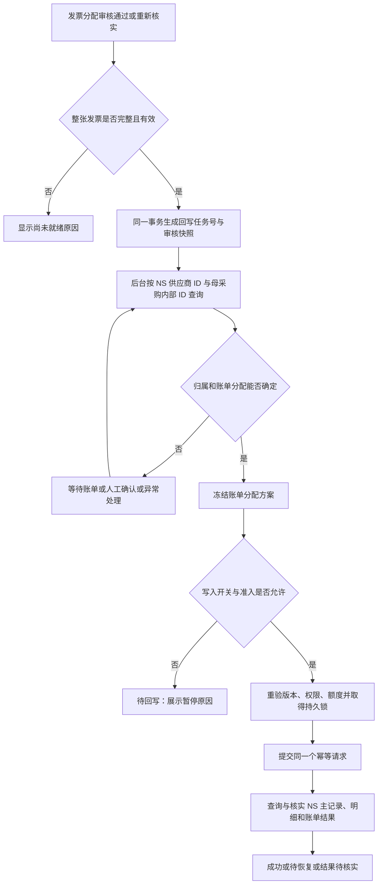

# 发票审核完成后生成 NS 回写任务：完整实施方案

日期：2026-10-27，2026-10-28 更新。状态：**阶段 A/B 已实现，阶段 C 写入仍为计划**。主线已接入整票就绪检查、事务内入队、历史补扫、只读账单查询、人工归属确认、不可变方案和真实回写页面。部署与当前边界以[操作说明](ns-writeback-prepare.md)为准。下文完整设计中涉及 apply/status/recover、NS 请求账本及真实写入的内容尚未实现。

## 1. 已确认的业务方向

**以一张发票完全匹配并审核通过为触发条件，自动生成回写任务号；后台按 NS 供应商 ID＋母采购内部 ID 查询账单，确定分配后登记 NS。** 不等待开票任务结束，也不要求关联的所有子采购全部收齐发票。

- 一张完整发票对应一个登记单元，可涉及多个子采购、母采购和账单；不按子采购各建一条重复发票主记录。
- 开票任务反映应开、已收和资料进度；回写任务反映该发票是否已登记 NS。两个状态分别显示，首期不把回写成功作为开票任务完成的新增条件。
- 审核通过自动生成任务，正常、可自动确认的账单无需再点一次通用“确认回写”；账单选择或金额分配有歧义时，需要专项人工确认。
- 用户按供应商名称查看业务，后台使用已存的 NS 内部 ID；不要求补录 `vendorCode`，不以名称模糊匹配作为写入身份。
- 生成任务不等于执行：写入开关关闭时也能生成、查询、核对和处理异常，但不调用 NS 写操作。
- 首期准入为正常、正金额人民币发票，同一目标 NS 账套、同一 NS 供应商及同一真实采购子公司。跨账套、跨供应商、跨子公司、红字/红冲/作废和未明确口径的零税额业务先阻断，保留原因，不擅自拆成多条登记。

示例：一张子采购应开 100,000 元，先收到一张 30,000 元发票。这张发票完全匹配并审核通过后即生成回写任务；子采购余下 70,000 元继续跟进。反之，一张 30,000 元发票只分配了 20,000 元，即使每条商品行都有一条分配，也不能生成可执行回写。



## 2. 方案制定时的差距（阶段 A/B 已按操作说明实施）

| 当前事实 | 本次方案要求 |
| --- | --- |
| matching 审核分配后发布 `AllocationChanged`，task 更新收票进度 | 增加按发票判断就绪、持久入队的链路，保留原事件含义 |
| `AllocationChanged` 主要携带子采购行汇总，没有完整发票身份 | 新增明确携带受影响发票 ID 的事件，不能从任务收齐反推整票审核 |
| 页面“已匹配”主要按有效分配覆盖的发票行数判断 | 单独实现整票就绪策略，逐行检查数量、金额和版本；不能复用展示标签作为入队条件 |
| source 保存供应商名称、`ns_internal_id`、`ns_account`；子采购关联母采购 | 通过 source 只读门面取得身份和母单上下文，不要求新增供应商编码 |
| 新只读接口已接收 NS `vendorId`，但与 matching 无连接 | 补齐服务端从本地审核快照取得身份的门面与队列工作线程接入 |
| 原 writeback 已归档，主线没有执行队列 | 恢复专用 writeback 业务模块，按本方案重建；不直接恢复旧通用任意字段写入口 |
| 前端 /writeback 已有未接入页面与演示，仍使用手工预览、确认执行契约 | 复用现有页面组件，改为审核后任务列表、账单方案与异常确认；不能将演示成功当成真实回写 |
| 第 0 期发现近期子采购精确关联缺失、历史金额差异和重复登记风险 | 母采购查询只返回候选；需证明归属并拦截异常，不能把母单候选当成子采购精确关联 |

依据：[匹配模块](../backend/modules/matching/README.md)、[现有匹配状态策略](../backend/modules/matching/policy/invoice_match_policy.py)、[有效版本取值](../backend/modules/matching/service/ledger_service.py)、[供应商表](../backend/modules/source/entity/supplier.py)、[当前只读查询说明](ns-vendor-bill-query.md)。第 0 期证据保存在本地 `outputs/ns-writeback-audit-20261027/`，不作为可移植部署依赖。

本方案替代此前“必须先在同步阶段补齐每张子采购的账单 ID 才能回写”的前置要求。同步可提供缓存，但精确目标通过回写任务实时查询与确认；历史数据修复另行处理。

## 3. 整票就绪：触发条件必须在后端判定

### 3.1 匹配审核完整性

在同一个本地事务中，读取当前发票版本和完整分配台账，至少满足：

1. 发票为有效正常正向发票，明细完整，号码、日期和含税总额明确；有效明细集合非空。
2. 当前所有有效商品行均分配完整：已审核有效分配金额之和等于该行含税金额；数量存在时，发票口径分配数量之和等于该行数量。不能只检查是否存在一条 confirmed 记录。
3. 各行汇总与发票票头含税总额一致。票头与明细存在差异、折扣/负行未能正确表达或数量规则不适用时，返回待核实原因，不静默补差。
4. 所有参与登记的分配均为 `confirmed` 且 `verification_status=valid`；当前有效明细范围没有未处理的 proposed 或待复核占用。驳回、取消的历史记录不参与金额汇总。
5. 分配的**有效**发票版本、有效开票依据与当前版本一致，单位换算证据有效；读取 `verification_history` 中最新有效版本，不能只看最初绑定的列。
6. 子采购与来源仍有效。人工允许的采购超开仍需保留原审核说明；超开审核不意味着允许超过 NS 账单可收额度。

金额使用 Decimal/DECIMAL，数量用已定义的存储精度。不能套用任务“收齐容差”来把少分配 0.01 元算成完整发票。首期遇到拆分金额无法按 NS 货币精度准确表达时，进入金额分配待确认；不得每行独立舍入后假定总额自然相等。任何调差必须有明确依据和审核快照。

### 3.2 入队与可执行分开

符合整票完整性时自动生成任务号。目标身份或 NS 条件尚未满足的任务仍可存在，但状态为阻断/等待，并显示原因：

- 供应商、母采购、目标账套缺失或冲突；实际采购子公司映射不明确。
- 候选账单未确定、币种不一致、超额、未批准、作废、历史主明细差异、疑似重复登记。
- 第一阶段无写能力、写入开关关闭或不在试点白名单。

整票本身未完整审核时不产生“待执行”任务，用发票详情的 `writebackReadiness.allowed/reasons` 解释缺少哪行、哪个金额或版本。历史扫描与人工“重新检查”使用同一策略，不能绕过条件。

## 4. 任务号、快照与防重复入队

### 4.1 三种身份分开

| 身份 | 建议用途 |
| --- | --- |
| `taskNo` | 人可读任务号，例如 `NSWB-20261027-000001`；数据库唯一分配，不按前端时间或进程计数生成 |
| `taskId` + `approvalFingerprint` | 标识一次整票审核内容；同一发票同一有效审核快照只生成一个任务 |
| `requestId` + `payloadHash` | 标识一次冻结后的 NS 登记请求；超时、状态查询和受控恢复始终沿用，不随重试改变 |

同一发票至多一个未解决的登记任务。发票换版不构成“可以再登记一次”的许可：旧任务已成功、执行中、部分完成或结果未知时，必须先核实旧登记；不能仅因 `invoiceVersionId` 变了就生成新的可执行请求。

### 4.2 两层不可变快照

**审核快照**在入队时固定：发票 ID/版本、真实发票标识、开票日期、销售方/购买方身份、币种和含税总额；逐行有效分配、数量和换算证据、有效开票依据、子采购身份、供应商和母采购来源摘要；审核人及审核时间。

**目标快照**在账单匹配/人工确认后固定：目标账套、实际供应商/子公司、各母采购与账单 ID、发票→子采购→账单的金额分配、归属证据、查询结果与读取时间、确认人及版本。它引用审核快照，不可反向修改已审核的发票金额或子采购分配。

账单目标调整产生新目标版本，保留旧版本和原因。NS 请求一经持久化为准备发送，不再修改该请求正文；只有证明旧请求没有任何副作用后才能废弃并生成新请求。签名凭据、读取时间等短期授权材料不混入业务内容摘要，避免仅刷新凭据就误判内容变化。

### 4.3 原子触发与补偿扫描

- matching 在确认、人工分配、重新核实、原子替换等**整个用例的最后**发布 `InvoiceMatchingChanged(invoice_ids, actor, reason)`（拟定名）；不能在替换中间状态或审核历史尚未保存时提前冻结。
- writeback 订阅方在同一 Connection/事务内，经 matching/invoice/source/review 的只读门面计算就绪并登记本模块任务；不调用 NS。
- 本地写失败则整个审核事务回滚。提交后即使进程退出，任务仍在队列中。
- 原 `AllocationChanged` 继续只用于任务进度，不改变其语义；事务内发布多个相关事件时按固定次序完成最终状态后入队。
- 定期补偿扫描已完整审核发票，复用同一入队策略和数据库唯一约束，修复漏触发，不重复创建。首次启用的历史扫描只生成待核实任务，不直接发送积压记录。

## 5. 供应商和母采购如何定位账单

### 5.1 从已审核业务读取真实身份

```text
发票有效分配
  → source 子采购行及子采购头
  → source_suppliers：ns_account + ns_internal_id
  → source_parent_orders：order_no + ns_internal_id + 币种
  → 按目标 NS 账套、供应商 ID 分组，以母采购内部 ID 列表批量查询
```

身份由后端获取，不相信前端自行提交的 NS 供应商 ID、账户或角色。本地供应商 ID 不等于 NS ID；名称只用于展示与辅助核对。`classification:*` 不是 NS 子公司 ID，必须通过母采购/账单的真实 subsidiary 和业务公司映射核实。销售方/购买方名称审核中的差异说明不能直接替代 NS 供应商和采购子公司的明确归属证据。

### 5.2 查询接口调整

独立只读 RESTlet 契约已升级到版本 3，后端只读调用已接入，队列接入仍待实施，内部请求示例：

```json
{
  "action": "bills",
  "vendorId": "1234",
  "purchaseOrderIds": ["5678", "5679"]
}
```

`vendorId` 是示例 NS 内部 ID，不是 V001 形式的编码。服务端固定连接目标账套，响应必须带真实 account，并与任务快照一致。

NS 端先校验供应商存在且有效；按 1–20 个不重复的母采购内部 ID 定位并逐单核对供应商，后端复核账单的供应商、母单、币种与公司。每个母单按请求顺序返回 `FOUND / NO_BILLS / PO_NOT_FOUND / VENDOR_MISMATCH`。不再通过单号定位或调用平台 `getData`，不按日期、税额或可收为零过滤，也不依赖子采购自定义字段一定有值。

按母单返回候选账单 ID、编号、供应商、币种、子公司、审批/作废状态、税额标志、子采购引用、两位小数字符串金额、有效明细合计及一致性标志。后端复核 Decimal 算式与标志，历史明细差异返回中文问题提示。写前 inspect 仍须重新核实主明细、关联列表、已有发票登记和异常原因，不能把查询结果当作原子快照。

原版本 1/2 未部署，仓库调用方为核对工具与测试，已同步替换；版本 3 不接受 `vendorCode / purchaseOrderNo`，也不把编码或单号解释为 NS ID。当前独立查询接收 NS ID；后续业务队列应从任务/本地身份解析上下文，不让浏览器自由选目标账户。母采购参数取 `source_parent_orders.ns_internal_id`，不是本地主键、`order_no` 或子采购上带显示前缀的 `parent_order_no`。

### 5.3 母采购候选不等于子采购精确归属

| 查询结果 | 处理 |
| --- | --- |
| 唯一账单且已有精确子采购/行级归属证据，所有校验通过 | 可自动生成目标快照 |
| 唯一账单但子采购引用为空 | 需现有、经审核的母采购结算范围规则或人工确认归属；仅“唯一”不够 |
| 多张账单 | 返回全部候选，按可证明的明细关系自动分配，不能证明则人工选择和分配 |
| 母单返回 NO_BILLS | 当前权限可见范围内未查到账单；新版不再受日期/零税额/已收齐过滤，仍须区分权限边界和真正未生成 |
| 读取失败或范围不完整 | 查询失败，可受控重查；不能当作空结果或继续写入 |
| 金额、供应商、币种、公司或重复登记冲突 | 阻断，进入异常清单 |

归属证据单独保存来源、确认人、时间和有效范围。人工确认账单只补充目标，不修改原发票分配；改变原子采购或金额必须重新走匹配审核。

### 5.4 分组与金额守恒

- 多个子采购属于同一供应商同一母采购时只查询一次，但保留逐子采购的分配台账。
- 同一账单被多个子采购分配使用时，额度检查按该账单**本次合计**，更新累计字段一次；不能每个子采购都使用整张账单剩余额度。
- 本地保存 `(allocationId, 子采购, 母采购, billId, amount)` 的映射；每条原审核分配的目标金额之和等于原金额，全部目标金额之和等于整张发票金额。
- NS 明细优先按 `(账单, 母采购, 子采购)` 表达，同账单可有多条来源明细，而账单更新按 ID 聚合。该结构须验证现有子表及事件脚本兼容性；未验证前阻断“一账单多子采购”试点，不能只保留第一个子采购或重复创建发票。

## 6. 队列状态与操作

| 状态 | 中文 | 可执行动作/退出条件 |
| --- | --- | --- |
| `queued` | 待匹配账单 | 领取只读查询任务 |
| `matching` | 正在匹配 | 保存完整结果；只读工作租约过期可重新领取 |
| `waiting_bill` | 等待账单 | 已证明未生成账单；按退避周期或人工刷新重查 |
| `needs_confirmation` | 待确认账单 | 选择候选、确认归属及金额；带目标版本，过期返回 409 |
| `blocked` | 暂不能回写 | 处理金额、身份、币种、历史重复等原因后重新核实 |
| `ready` | 待回写 | 已有冻结目标；开关关闭/不在白名单时继续保持并显示暂停原因 |
| `executing` | 回写中 | 仅核实状态，不重复发送、不修改已冻结正文 |
| `recovering` | 部分完成待恢复 | 已知有副作用；检查已完成步骤后由受控恢复器续做 |
| `unknown` | 结果待核实 | 超时、进程崩溃或本地结果保存失败；禁止普通重试 |
| `succeeded` | NS 回写成功 | 全部主明细与账单更新核实完成，保存 NS IDs |
| `registered_externally` | NS 已由其他方式登记 | 独立核对已有记录完全一致并人工确认；不冒充本系统回写成功 |
| `stale` | 审核内容已变化 | 无副作用且内容失效；重新审核后可生成后继任务 |
| `cancelled` | 已取消 | 仅尚未执行且已证明无副作用时可取消，保留历史 |
| `needs_correction` | 已登记内容待更正 | 已成功后发票/分配变化或 NS 被修改；禁止重新登记同一发票 |

`retryable/reason` 与 `lastError/nextCheckAt` 由后端返回，不用一个“失败”状态混合未写入和已部分写入。明确证明 NS 拒绝且没有副作用的失败，回到 ready/blocked；无证明则 unknown。终态历史不可覆盖；success 后发现变化，通过事件记录转入 needs_correction，同时保留原成功证据。

开关分别控制入队、只读查询和 NS 写入，默认写入关闭。关闭写入停止新的提交，但允许只读核实；已在途请求不宣称被取消，部分完成的恢复写操作也受写入开关控制。

## 7. NS 回写对象、接口与执行顺序

### 7.1 保持现有业务对象

| 对象 | 内容 |
| --- | --- |
| `customrecord_swc_vendor_invoice` | 每张发票一条主记录；供应商、发票号码、开票日期及本系统来源追踪 |
| 现有供应商发票明细 | 账单、母采购、可证明的子采购、本次金额；“此前已收”等取写前实时值 |
| `vendorbill.custbody_swc_vendor_amount` | 对应账单累计已收发票金额 |
| `vendorbill.custbody_swc_bill_vendor_num` | 发票主记录 ID 的多选关联，去重追加；不是发票号码文本 |
| 新增 NS 请求账本与执行步骤记录 | 请求身份、业务键、正文摘要、执行阶段、主明细 ID、逐账单结果与异常 |

开票日期保存在供应商发票记录，不修改账单单据日期。主记录新增 requestId 文本字段只用于追溯，**不能替代独立请求账本**，否则删除主记录后可能重放、并发首提也可能重复。

### 7.2 拟定接口边界

只读查询 RESTlet 与写入 RESTlet 分开部署、独立配置；只读身份无需开放写权限。写接口只服务固定供应商发票登记用例，不恢复任意记录/任意字段写入能力。

- `bills`：已实现的独立只读版本 3 查询，按供应商 ID＋母采购内部 ID 列表返回分组候选；它不签发写入凭据。
- `inspect`：核实任务候选、额度、主明细一致性及已有发票登记；返回服务端绑定账套、供应商、母单、候选的凭据/版本。凭据不预留额度。
- `apply`：提交冻结请求；返回 `SUCCEEDED` 或 `PROCESSING` 等明确状态，不能把“已接收”当成完成。
- `status`：按请求 ID 查询处理阶段与实际结果。权限与来源隔离同 apply。
- `recover`：仅对已核实的部分完成请求续做指定未完成步骤；不是普通重试入口，不接受任意更改金额。

拟定 apply 业务正文示例（虚构 ID）：

```json
{
  "action": "apply",
  "sourceSystem": "financial-invoice-system",
  "requestId": "持久保存的请求UUID",
  "taskNo": "NSWB-20261027-000001",
  "matchToken": "NS绑定本次范围的凭据",
  "vendorId": "1234",
  "invoice": {
    "identity": "规范化真实发票标识",
    "number": "发票号码",
    "date": "2026-10-27",
    "currency": "CNY",
    "amount": "30000.00"
  },
  "allocations": [
    {"lineKey": "稳定明细键1", "billId": "90001", "purchaseOrderId": "80001", "subPurchaseOrderId": "70001", "amount": "10000.00"},
    {"lineKey": "稳定明细键2", "billId": "90001", "purchaseOrderId": "80001", "subPurchaseOrderId": "70002", "amount": "20000.00"}
  ]
}
```

NS 不信任调用方自报已审核、已收金额或任意 billId。它须校验调用身份、请求账本、匹配凭据、所有归属、版本及最新额度；本地审核状态由受控后端和不可变任务保证。首期建议限制每张发票最多 20 张账单，最终上限以沙箱实测为准；超限暂停或使用一个请求下的 NS 异步步骤，**不能把完整发票拆成多个独立请求和主记录**。

### 7.3 提交流程

1. 本地工作线程事务外获取完整 NS inspect 结果。
2. 本地短事务按既有账本锁序重验审核及目标快照，核对操作者授权、账套、供应商白名单和开关；取得发票保护记录及全部目标账单持久锁，按账单 ID 固定排序。
3. 持久化请求正文、摘要和 `executing` 意图，提交事务后才发网络请求。工作租约与目标保护锁分开；不能长时间持有数据库事务等待 NS。
4. NS 统一写入协调器取得该请求及所有目标账单的排他执行权，重新读取账单/额度、重复记录及有效明细；检查整单全部条件后才创建主记录及明细。
5. 登记每一步结果，按账单聚合更新累计及关联；回读核实全部结果后完成 NS 请求账本。不能假设多个记录保存天然整体回滚。
6. 本地记录 NS 主记录、逐账单结果和完成证据，再释放目标保护锁。若本地落结果失败，转入状态核实，不重发创建。

## 8. 幂等、并发、未知结果与历史金额

### 8.1 双重防重复

- 传输幂等：`目标账套＋sourceSystem＋requestId` 唯一。同正文返回已有状态/结果；不同业务正文返回冲突。由 NS 服务端自行规范化和计算摘要，不能相信客户端传入的 hash。
- 业务防重：对真实发票标识规范化；数字票与传统发票代码＋号码分别定义规则，并结合供应商/开票方身份和目标账套。**不能仅把来源系统加进键就允许同一发票从不同渠道重复登记**。
- 已有人工登记或其他系统记录：完全一致也先进入已外部登记核实流程；不一致进入 conflict，不默认追加金额或自动覆盖。
- 并发首提依赖可验证的唯一占用机制；不能采用“先搜索，没有就创建”作为唯一保证。NS 唯一记录标识/锁实现须在目标环境做并发验收后定型。
- 请求账本、业务防重键和步骤记录独立保留，主记录被删除也不能使旧请求重新创建发票。

### 8.2 所有写入口必须协调

本地账单锁只能协调本系统，无法阻止 NS 网页、编辑删除事件、其他集成和补金额脚本。

上线前必须让试点范围内的所有入口遵循同一 NS 排他写入规则：网页保存改调统一服务；编辑/删除路径接入统一协调或在试点范围明确限制；其他集成和维护脚本同样纳入。不能只让新 RESTlet 加锁，也不能仅凭“大家不要同时操作”的约定宣称解决并发。

局部试点如暂不能改造全部入口，应在服务端可靠阻止这些入口修改试点对象，并验证拒绝行为；不能停用整个账套旧平台影响非试点业务。达不到隔离条件则保持只读。NS 锁过期不能使旧工作线程继续写：需所有权/代次校验及崩溃恢复；未证明旧执行已停止，不自动接管目标锁。

### 8.3 不借回写修历史错账

写前累计字段与有效发票明细、关联列表有实质差异时阻断。第 0 期异常账单逐条处理，不能自动改成“直接加本次金额”来绕过，也不能未经确认重算覆盖历史。

仅在已核实一致、排他执行的范围内，从有效主明细重算目标累计和关联，作为可重复执行的确定结果；已生成明细不再次创建。有效性的定义必须统一覆盖停用、删除、部分完成请求和更正状态，并验证现有报表的可见性。未完成主记录如何对旧网页显示需明确标记及阻断重复登记，不能把半成品算作完整成功。

旧平台金额公式、贷项、付款、零税额及尾差需通过只读对照确定为同一业务口径，再使用可靠十进制运算实现写前验证；付款金额不直接当作收票金额。版本 3 查询使用整数分运算并由后端 Decimal 复核，但非人民币口径与真实数据仍待联调，不能直接升格为写入金额依据。

### 8.4 结果未知与内容变化

- HTTP 超时、收到响应前崩溃、NS 成功后本地提交失败：进入 unknown，保留目标锁和原请求 ID；先查 NS 请求账本及实际记录。
- NS 已创建主记录、只更新部分账单：进入 recovering，锁定同一请求，仅补未完成步骤。即使“保存成功但步骤状态没记上”，也要通过稳定业务键和实际记录认领，不重复创建。
- 一次查不到请求不能自动证明没有写入：须确认无在途执行、NS 唯一请求标识及相关记录均无副作用，才可受控重发同一请求。
- 启动不自动把 executing/unknown 清零，不按超时释放保护锁。只读匹配阶段的工作租约可恢复，但不能与写入阶段混为一谈。
- 未发送时发票换版、取消分配、依据失效：旧任务 stale，保留历史；重新审核后建立后继。
- 执行中禁止用户直接改变已授权分配并重排发送。外部发票作废/换版、NS 数据变化等事实仍需接收并标记“执行期间发生变化”；先核实当前请求，再进入更正，不能丢弃事实或另开重复任务。
- 已成功后变化：needs_correction，走独立更正审批与 NS 核实。首期不自动红冲、删除、置零或负数抵减，不直接调用现有行号式编辑/删除链路。

## 9. 模块与数据设计（拟新增）

### 9.1 职责和依赖

恢复 `backend/modules/writeback/`，按 controller/service/dao/entity/dto/vo/policy 分层，前端对应 `writeback`。这是本方案对当前“已归档”状态的计划性变更；实施时同步更新架构目录、表归属与静态依赖检查，不在此次文档阶段改为已实现。

| 模块 | 拟承担职责 |
| --- | --- |
| matching | 整票匹配有效性/完整性策略、只读审核快照门面、新增发票变更事件；保留原分配规则 |
| invoice | 提供当前版本及真实发票身份，沿用版本变化事件 |
| source | 供应商 NS ID、母采购和公司上下文门面；NS 候选查询和身份范围核验 |
| writeback | 入队、不可变目标方案、状态机、工作线程、请求与恢复、目标锁及审计 |
| task | 原开票进度不变，不读取 writeback 私有数据来决定原任务是否完成 |
| integrations/netsuite | 固定只读/写接口传输、认证、限长、超时；不判断业务审核 |
| app.py | 依赖装配、订阅登记和工作线程生命周期，不堆业务规则 |

读取方向：writeback → matching/invoice/source/review 的 public.py；不直接访问对方 DAO 或表。跨模块变化经事件，同一事务传递 Connection；订阅方不调用外部接口。审核、取消、发票变化等入口需统一接入失效处理，不只改一个确认按钮。

### 9.2 本地持久数据

建议最小表集如下，均待正式数据库设计与迁移落实；不得在已有迁移文件中追加修改：

| 表（拟名） | 主要内容和约束 |
| --- | --- |
| `writeback_tasks` | taskNo、发票/审核版本、状态、目标账套、来源快照、当前目标版本、NS 主记录 ID、阻断原因；唯一 taskNo 与 `(invoice_id, approval_fingerprint)` |
| `writeback_invoice_guards` | 每张本地发票一条保护记录；当前未解决任务、登记结果及版本，锁住换版/重入队；与 NS 业务防重共同防止重复来源 |
| `writeback_plans` | 不可变目标版本、候选读取快照、逐分配到目标的映射、金额、证据、摘要和确认人；`(task_id, revision)` 唯一 |
| `writeback_requests` | 每个冻结请求的 requestId、计划版本、正文及摘要、发送意图、NS 处理阶段与核实结果；重复网络尝试不新建业务 requestId |
| `writeback_target_locks` | `(ns_account, record_type, ns_id)` 唯一；所属请求、取得时间、保留原因；不能因普通工作租约过期删除 |
| `writeback_audit` | 追加的入队、状态变化、选择、发送尝试、核实、恢复与更正证据，记录真实操作者；不记录私钥和 token |

工作线程租约、attemptCount、nextCheckAt 可放任务/请求表，不另建通用任务框架。目标计划保存完整 JSON 明细且写后不可修改；若查询需求要求独立行表，在本模块细化，不能使 DAO 跨模块读表。跨模块只存 ID，不建外键；主键、UTC 时间、Decimal 及中文字段说明沿用数据库规范。

旧 `ns_previews/ns_target_locks/ns_audit` 保留。实施前只读检查历史 executing/unknown；若与目标账套/账单重叠，必须作为试点阻断。不得清空旧锁或把旧数据直接转换为已成功的新任务。

## 10. 页面与本地接口（拟定）

- 在发票比对详情显示“整票就绪原因、回写任务号、当前状态、目标账单、最后核实时间”。金额只展示后端字符串，不由前端判断能否写。
- 新增独立 `/writeback` 列表与 `/writeback/:taskId` 详情，路由集中登记。列表支持供应商、发票、母采购、状态及时间筛选，由后端分页统计。
- 详情分开展示审核分配、NS 候选、确认的账单分配、请求结果和审计时间线；正常路径不加重复审核按钮。
- 待确认允许选择账单/分配金额，后端校验当前版本、归属、金额守恒与额度。未知结果只显示“核实结果”，不能提供通用“重试回写”。
- 后端返回各动作的 `allowed/reason`。操作人来自登录身份，服务调用身份与工作线程权限分开；不能把 `service:` 身份变成人工审核者。
- 使用项目统一组件库，覆盖加载、空结果、失败、未部署和正常数据状态；不开模拟成功，不将查询唯一显示为“已回写”。

拟定 API：`POST /api/writeback/tasks/query`、`GET /api/writeback/tasks/{id}`、`POST .../{id}/refresh-match`、`POST .../{id}/confirm-plan`、`POST .../{id}/reconcile`、`POST .../{id}/cancel`。恢复动作单独受控，不能等同 retry。修改动作带 requestId 和任务/计划版本；入队主要由事件触发，不暴露任意创建已审核发票任务的入口。所有接口在有真实页面/运维调用方时才实施。

## 11. 分期、依赖与交付

| 阶段 | 工作 | 交付与完成条件 | NS 写入 |
| --- | --- | --- | --- |
| A：就绪与本地队列 | 明确逐行完整性，增加门面/事件、不可变审核快照、幂等入队和失效 | 完整发票自动产生任务号；部分分配不误入队；宕机不丢任务；历史只核实不发送 | 无 |
| B：ID 查询与目标确认 | 独立查询已改为 `vendorId`；待接队列查询、目标方案与页面 | 相同条件与现网网页真实只读对照；账套隔离正确；金额与归属可追溯 | 只读；脚本部署单独登记 |
| C：NS 可靠登记 | 独立请求账本、唯一业务键、写入口协调、确定步骤和恢复接口 | 沙箱并发、断点、超时、事件联动全部验收；不可用模拟替代 | 测试环境 |
| D：生产白名单试点 | 清理试点前提，核实历史手工登记，约定切换范围，开启少量供应商 | 每张回写逐账单核实，关闭开关和恢复流程演练；异常不扩大范围 | 经明确放行的范围 |
| E：扩大范围 | 根据试点异常与运维能力扩大供应商 | 有连续稳定证据与财务核对记录；更正机制明确，未解决异常保持隔离 | 分批开启 |

恢复后端 writeback 模块、NS 部署、现有平台写入口改造与生产放行是不同交付，不能用“代码已提交”代替完成。阶段 A/B 可以独立推进，阶段 C 未通过前不会因打开某个环境变量而自动写入。

历史积压任务启用前逐票核实是否已手工登记、版本是否仍有效及是否重复来源。完全一致且人工确认的标记 registered_externally；其他阻断。不把所有历史 ready 一次性释放。

建议协作：应用开发负责本地队列/门面/页面，NS 开发与管理员负责字段、角色、部署及全写入口协调，财务负责归属、历史差异和试点对照。本文不虚构工作日排期；阶段 C 依赖现网入口核实，不能在核实前承诺上线日期。

## 12. 必须覆盖的验收用例

| 场景 | 预期 |
| --- | --- |
| 每条发票行都有分配，但一行仅分了一部分 | 不就绪，明确剩余数量/金额 |
| 最后一条分配审核通过、批量审核、人工分配、替换、重新核实 | 最终整票状态一致时只生成一条任务，不在中间态入队 |
| 两人同时审核最后几条、重复事件、补偿扫描与审核同时发生 | 数据库唯一约束和发票保护行保证不重复；MySQL 实测 |
| 存储版本列旧、复核历史已承接新版本 | 依据有效版本判断，不误用最初版本 |
| 同名供应商或本地 ID 与 NS ID 不同、沙箱与生产混用 | 按真实 NS 身份及账套核验，越界拒绝 |
| 同号母采购多条、母采购供应商不符 | 歧义/阻断，不取第一条 |
| 多子采购共母采购、共账单 | 查询去重、额度按账单合计、原子采购分配可追溯 |
| 已收齐、零税额、日期外账单及权限失败 | 前三类在版本 3 中照常返回；权限失败与真正未生成区分，不误等待或误写 |
| 一票多母采购、多账单，其中一张校验失败 | 整票不启动新写入，不能先写合格部分 |
| 额度在匹配后被其他任务占用 | NS 排他区内重新校验，拒绝超额 |
| 同请求同正文、同请求异正文、跨来源同发票 | 返回原结果或冲突，不重复创建 |
| 创建主记录后崩溃、更新第一张账单后崩溃、成功响应丢失 | 逐步核实后恢复，不重复主明细或重复加金额 |
| 本地标记发送后崩溃、NS 完成后本地结果提交失败 | 保留锁，核实原 requestId；不重启自动重发 |
| 旧网页保存、编辑、删除、维护脚本并发 | 统一协调或可靠拒绝试点目标，不能覆盖累计金额 |
| 发票取消/换版/作废发生在 queued、executing、succeeded | 分别失效、先核实、进入更正；不产生第二次登记 |
| 历史金额差异、删除过的发票主记录、旧未知锁 | 阻断；不借重算修复历史、不因记录删除丢失防重 |
| 新启动/重启、关闭写开关、多进程领取 | 工作租约正确；executing/unknown 的保护锁不自动清除 |
| 非两位小数分配、尾差、跨币种、跨公司 | 按批准规则处理或阻断，不静默舍入/换汇/拆票 |

本地金额/状态/权限测试、迁移回滚测试及 **MySQL 实际并发测试**必须执行；NS 沙箱需要真实并发和故障恢复验证，并核实触发的用户事件与字段类型。UI 检查桌面/小屏、各状态和提交冲突。生产试点只在上述证据完整后放行，不因单元测试通过宣称财务登记已验证。

## 13. 当前待验证事项与明确边界

以下不阻止开始本地队列开发，但都阻止未经核实的自动写入：

1. 现网集成身份对账单实际读取和保存的限制来源；不能从 SuiteQL 可读推定可写。
2. 近期账单实际生成流程与子采购归属依据；母采购结算范围是否有可审核的明确规则。
3. 发票代码/号码或数字票身份的规范化、防重复范围，以及销售方/购买方与 NS 主体映射。
4. 平台金额在贷项、核销、零税额与停用/删除记录中的准确口径；金额异常须逐条处理。
5. 同账单多子采购明细、NS 主记录事件、旧平台编辑/删除及其他集成的兼容和协调方案。
6. NS 请求唯一占用与所有权检查的可实施机制、部分完成记录的可见性和恢复证据。
7. 试点供应商、切换范围、积压任务核对、异常处理人及更正流程。

方案编制时未修改业务代码或部署脚本。后续仅将独立查询参数调整为 NS 供应商 ID 并只读核实本地来源数据，未创建回写表/任务或触发 NS 查询/写入。完整队列实施仍按阶段 A，再按阶段 B/C/D 的验收门槛推进。
