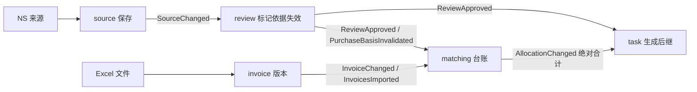

# 系统整体链路与实现关系

2026-10-15：当前分支使用 source → review → task → invoice/matching 新链路；4d A—D 已实现，4e 删除了旧实现。代码完成不代表目标环境已部署迁移、配置 NS 或完成真实数据验收。

| 页面 | 接口 | 归属与持久化 |
| --- | --- | --- |
| `/sync/ns` | `/api/ns/sync/{kind}/pull-save` | sync 编排 source；`source_*` 保存来源与原始证据 |
| `/pl-reconciliation` | `/api/source/pl-comparison` | source 实时只读查询，不自动保存或审批 |
| `/review` | `/api/review/declarations/query`、`/{id}/approve` | review 保存报关审核和全局开票依据 |
| `/tasks`、`/tasks/:id` | `/api/tasks/*` | task 保存任务、合同、通知与状态历史 |
| `/sync/lemon`、`/invoices` | `/api/invoices/import/*`、`/api/invoices` | Excel 发票、原始数据、不可变版本 |
| `/matching`、`/matching/:invoiceId` | `/api/matching/*` | matching 建议、确认、取消、复核、原子替换 |

旧前端 `/finance-reconciliation` 和 `/invoice-followup` 保留跳转；旧 `/api/reconciliation/*` 已删除。没有正式 dashboard/exception 模块或演示成功入口。

订阅顺序显式登记在 `backend/app.py:create_events`，审核先生成任务再重算；所有订阅复用发布方事务，任一步失败整体回滚。跨模块读经 `public.py`，不读写对方私有 DAO。

采购依据冻结主体、币种、数量、单位、金额和原始引用。多张报关单引用同一采购行时复用依据与任务额度；来源关键内容变化则待复核，重审后生成后继任务，包括已经完成的任务。兼容旧分配可以承接，收票数额来自台账，不复制旧任务缓存。

发票当前字段是版本投影。相同内容重复导入不增加版本；同来源变更追加版本，原确认保留并进入复核。明细重排不改变逻辑身份；身份歧义或缺少明细时保留旧行并禁止确认。作废/红冲立即撤销有效收票资格，原占用保留到取消或替换。

分配保留发票口径和采购口径数量，不同单位由后端按证据换算；发票自身数量金额不可超用。超开只提示，不能自动结束任务。按差异结束是 task 的独立决定，绑定依据和账本摘要，后续取消/失效/换版后撤销适用性。

资料准备、通知草稿和人工发送登记继续使用真实合同文件与持久记录。外部下载在事务外完成，登记与推进前复核来源；失败重试沿用首次文件身份，不能覆盖历史。企微自动发送尚未接入。

所有关联写先取得数据库级账本命名锁，随后取得账户锁及行锁。当前写操作串行化，保证一致性优先；长来源读取期间可能令其他写操作等待或返回 409。正常启动不执行同步、迁移或缓存修复。必要时管理员运行 `python -m backend.manage rebuild-ledger`，从持久分配重新计算缓存；该命令不会核实待复核记录。

唯一迁移链为 `backend/migrations`。`0005`—`0009` 保留既有 v2 数据并回填证据；无法还原的历史标记待复核。旧业务表、旧版本表及 NS 回写锁留在数据库，清理须管理员另行处理。部署与验证见[Python 后端](python-backend.md)。

下一阶段是第 5 步持久调度和 open2 真实明细接入；自动通知、权限角色、NS 回写另行设计。本次不触发真实 NS 写入。
