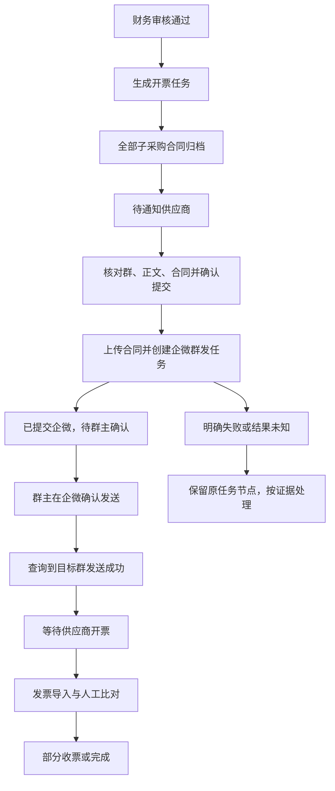

# 企业微信供应商开票通知接入方案

状态：**第一阶段代码已接入，真实环境验收待完成**。方案日期：2026-10-16；实现更新：2026-10-19。第 1—12 节保留设计依据，当前接口、实施差异及部署条件以第 13 节为准。本次仅使用隔离数据库和假企微验证，未向真实群发送通知。

## 1. 目标与范围

将开票跟进中的“通知供应商”接入企业微信客户群群发：从当前任务取得供应商对应群、通知正文和已归档子采购合同，自动上传附件、创建群发任务；群主在企微确认发送后，系统查询目标群发送结果，再推进到“等待供应商开票”。

**本期采用“用户确认提交，系统处理上传、创建与回执”的方式。** 财务审核通过、合同归档完成和保存通知草稿，都不直接触发对外发送。首期一项任务对应一个供应商群，一个通知版本对应一次群发提交，不做跨任务合并群发。

- 按原实测方案使用客户联系群发通道，不改用内部群机器人 Webhook。
- 按用户提供的实测结论，群主确认不能绕过；自动提交不等于消息已经进入客户群。
- 创建成功只显示“已提交企微，待群主确认”，不能当作供应商已读或已开票。
- 第一阶段提供页面内自动查询和手动刷新回执；关闭页面后不承诺持续后台轮询。无人值守回执同步列入第二阶段。
- 保留人工发送登记作为独立通道；自动通知执行中、待确认或结果未知时，禁止通过人工登记绕过核实。
- 不改发票导入、发票比对及任务完成规则，不接入 NS 回写。

## 2. 参考资料与当前实现

### 2.1 原测试方案

参考用户提供的《企微外部群群发功能设计总结.md》，位于 `C:/Users/Admin/WorkBuddy/2026-10-09-10-29-58/outputs/`。已阅读同目录 `wecom_api_test.py` 的群发实现，**没有运行脚本**。

脚本使用 `chat_type=group`、`chat_id_list`、`sender`、`text`、`attachments` 调用 `externalcontact/add_msg_template`；实际附件实现使用 `media/upload`，部分提示仍写 `upload_attachment`，正式接入应修正。该脚本没有本项目需要的持久幂等、版本校验、任务联动和渠道回执闭环。

官方复核入口：[创建企业群发](https://developer.work.weixin.qq.com/document/path/92135)、[群发记录与执行结果](https://developer.work.weixin.qq.com/document/path/93338)。2026-10-19 已通过浏览器读取官方创建群发、回执及临时素材文档，确认参数及限制，见第 13 节。指定测试群定向验收仍需在部署环境完成。

### 2.2 可复用代码与缺口

| 当前实现 | 复用内容 | 本次需补充 |
| --- | --- | --- |
| [企微适配器](../backend/integrations/wecom.py) | 凭证读取、令牌缓存、客户群查询、脱敏错误 | 上传附件、创建群发、查询发送结果 |
| [供应商群服务](../backend/modules/task/service/supplier_group_service.py) | 供应商主键绑定 chat_id；群主 userid 来自企微 | 发送前核对绑定版本和实时群主 |
| [合同服务](../backend/modules/task/service/document_service.py) | NS 下载、共享盘归档、来源与 SHA-256 | 发送前核对实际文件和冻结附件清单 |
| [通知服务](../backend/modules/task/service/notification_service.py) | 通知版本、人工登记、认证身份 | 自动通知执行台账与渠道回执 |
| [依据保护](../backend/modules/task/service/basis_guard.py) | 核对审核依据是否仍有效 | 外部请求期间变化的事后识别 |
| [任务状态服务](../backend/modules/task/service/task_status_service.py) | 统一状态转换和流转历史 | 接入渠道确认发送这一推进来源 |
| [通知界面](../frontend/src/modules/task/components/TaskNotification.tsx) | 接收信息、正文、合同、预览、历史 | 提交入口、待确认状态、刷新及核实 |

当前 `task_notifications` 已有 `channel/chat_id/channel_message_id`，状态仅为 `draft/sent/failed`。不能只补一个 HTTP 请求，把现有 `sent` 当作群发创建成功；执行过程和不确定结果需要单独持久化。

## 3. 总链路与状态

### 3.1 主任务状态沿用现有定义

| 事实 | 主任务状态 | 通知区域显示 |
| --- | --- | --- |
| 合同未全部归档 | `documents_pending` | 先保存全部合同 |
| 合同全部归档 | `notify_pending` | 待提交开票通知 |
| 上传或创建群发中 | `notify_pending` | 正在提交，请勿重复操作 |
| 创建被接受且目标群未被拒绝 | `notify_pending` | 已提交企微，待群主确认 |
| 目标群渠道发送成功 | 通常进入 `awaiting_invoice` | 企微已确认发送 |
| 明确失败 | 保持当前状态 | 失败原因与处理方式 |
| 创建结果不确定 | 保持当前状态 | 结果待核实，禁止重复提交 |

页面第 ③ 节点只有人工登记完成或目标群渠道确认发送后才完成。提交企微不能提前完成该节点，也不改变第 ④ 节点的有效收票口径。

回执晚于收票时，若任务已为 `partially_received/completed`，只补通知证据，不退回 `awaiting_invoice`。若任务为 `superseded`，保留旧任务发送事实，不推进旧任务或冒充新任务已通知。依据失效但尚未重审时，记录回执并提示复核；恢复后的状态通过统一重算入口处理。

任务摘要、六节点、流转记录、收票回退逻辑均须识别渠道来源，不能继续对企微渠道显示“已人工登记发送、尚无渠道回执”。

### 3.2 自动通知执行状态

| 状态 | 含义 | 后续动作 |
| --- | --- | --- |
| `preparing` | 已持久登记，正在核验文件或上传素材；未进入创建请求阶段 | 查询进度，中断后按创建前规则恢复 |
| `submitting` | 已落库标记即将或正在调用创建接口 | 禁止再创建；中断或超时转 unknown |
| `pending_confirmation` | 已取得 msgid，等待目标群发送结果 | 查询回执，不创建第二条群发 |
| `sent` | 已核实目标群成功发送 | 只读追溯 |
| `failed` | 明确未创建，或渠道明确给出目标群终止失败 | 根据证据决定是否允许新版本提交 |
| `unknown` | 请求可能生效，但无法证明结果 | 核实及关联渠道记录，禁止盲目重发 |

转换集中在 task 的 policy 中：`preparing → submitting/failed`；`submitting → pending_confirmation/failed/unknown`；`pending_confirmation → sent/failed`。查询网络失败保留原状态，仅记录查询错误。`unknown` 经证据核实可进入待确认、成功或失败，不能直接重置成草稿。相同回执重复到达须幂等。

## 4. 操作流程与提交条件

1. **配置供应商群**：复用现有绑定，以供应商本地主键、企微企业身份和 chat_id 定向，不按同名供应商或群名猜测。
2. **归档合同**：本任务全部子采购合同已归档，发送进程能读取文件。截图中的“共享盘路径尚未配置”必须先解决。
3. **保存通知**：沿用通知版本。自动通道的目标群和发送人来自绑定及实时群主；手填群名、员工姓名不能作为自动发送地址。
4. **预览确认**：展示供应商、采购公司、子采购单号、群名与 ID、群主、正文和合同清单，明确仍需群主确认。
5. **提交**：前端只提交任务 ID、通知版本、绑定版本、后端预览摘要和 requestId；群地址、正文、合同路径从服务端记录取得。
6. **等待与查询**：展示实际群主、提交时间和 msgid，提供刷新发送结果。
7. **回执推进**：只有目标群成功回执才记录渠道发送事实，按第 3 节更新任务。

后端再次校验：身份可写、发送开关开启、任务未替代且依据有效、合同齐全、通知为最新版本、绑定启用且版本一致、实时群主与预览一致、没有阻塞中的通知、满足配置的群级配额。任一变化要求重新预览。

不向浏览器返回 Secret、access_token 或上传鉴权 URL；正文不自动附加共享盘路径等内部信息。

## 5. 附件与外部接口

### 5.1 合同处理

- 只使用当前任务 `task_documents` 中已归档的合同，不接受前端任意路径。
- 解析实际文件路径，确认在合同根目录内，校验存在、可读、大小与 SHA-256；解析符号链接后的越界同样拒绝。
- 上传冻结清单对应的已校验文件内容，避免先校验再重新打开文件造成内容被替换。
- 采用 `media/upload?type=file` 获取 media_id，构造文件附件。任一附件上传失败，均不创建缺少合同的群发。
- 原材料中的“20 MB、9 个附件、素材 3 天有效”标记为待核实；按实际契约配置服务端校验。
- 首期附件超限整次阻止提交，保留人工流程；不静默截断，不自动拆成多次群发。文件字节不入数据库。

### 5.2 接口候选与验收条件

| 能力 | 接口 | 必须满足 |
| --- | --- | --- |
| 企业凭证 | `gettoken` | 复用现有配置与令牌缓存，日志不带鉴权 URL |
| 核实目标群 | `externalcontact/groupchat/get` | 查询确切 chat_id，核实群主和可见范围 |
| PDF 上传 | `media/upload` | multipart 上传，检查响应，不用欢迎语附件接口替代 |
| 创建群发 | `externalcontact/add_msg_template` | 仅一个目标群，核对 errcode、msgid 和目标失败结果 |
| 发送回执 | `externalcontact/get_groupmsg_send_result` | 按 msgid、实际 sender 查询，处理完整分页，精确识别 chat_id |
| 未知结果核实 | 群发记录、成员任务列表等只读接口 | 先核实可取字段，不凭相似正文自动认领 |

**定向性是上线前置条件**：必须确认 `chat_id_list` 在当前应用接口中受支持且确实限制到指定群。接口成功不代表参数必然生效。若参数被忽略、实际需要员工自行选择群，应暂停“自动定向”上线并调整方案；绝不能省略群参数后向群主全部客户群发送。

只有经过验证的渠道成功枚举才能推进；空结果、缺少目标群、任务整体完成、未知枚举和超时均不证明目标群成功。原文对 `40050` 的单一解释不作为代码规则，保留脱敏错误码，结合目标结果判断，不统一翻译成“今日额度用完”。

## 6. 数据模型建议

以下结构已由新增迁移 `0022_task_notifications` 实现，详见[数据库设计](architecture/database.md)和第 13 节；不修改既有迁移和历史数据。

### 6.1 现有表继续复用

- `task_supplier_groups`：保存当前绑定，不兼作历史接收目标。
- `task_documents`：保存合同归档事实及摘要。
- `task_notifications`：保存通知版本；实际渠道成功才写 `channel=wecom/status=sent/channel_message_id`。人工记录仍为 manual，不补造渠道回执。
- `task_events`：追加提交、失败、未知、核实和渠道确认事件，与主任务状态事件区分。

### 6.2 新增 task_notification_deliveries

一条记录代表一个通知版本的一次对外提交。首期每个通知版本只允许一条执行记录；明确失败后再次提交，先保存新通知版本，保留前次证据。

| 字段组 | 建议字段 | 规则 |
| --- | --- | --- |
| 身份 | `id/task_id/notification_id/request_id/request_sha256` | 模块内外键；notification_id 和 request_id 分别唯一；相同请求不同摘要返回 409 |
| 目标 | `corp_id/chat_id/sender_userid/group_binding_id/group_binding_version` | 冻结企业、群、群主、绑定版本；凭证切换不能拿新企业查询旧记录 |
| 快照 | `snapshot_json/snapshot_sha256` | 冻结正文、主体、任务与审核依据版本、群显示名、合同 ID/路径/文件名/摘要/大小 |
| 执行 | `status/created_by/submitted_at/channel_message_id` | 状态受约束，msgid 来自合法响应或核实流程 |
| 回执 | `channel_status/sent_at/last_checked_at/next_check_at` | 目标群实际结果；UTC 存储，北京时间展示 |
| 错误 | `error_code/error_message/evidence_json` | 脱敏证据，不保存令牌或带令牌的请求地址 |
| 恢复 | `lease_token/lease_expires_at/resolved_by/resolved_at/resolution_reason` | 执行领取与核实证据；租约过期不代表可重发 |
| 公共列 | `created_at/updated_at` | 复用 TIMESTAMP 和 timestamps() |

快照按规范化序列化计算摘要，由后端验证。含内部路径的完整快照不直接返回浏览器。非空 msgid 按企业与消息 ID 建唯一约束，防止同一渠道任务被绑定到另一项本地任务。

另新增 `task_notification_group_guards`，以 `(corp_id, chat_id)` 唯一保存群级守卫和 `active_delivery_id`。短事务行锁串行化同群不同任务的提交；未决执行持久占用守卫，确认结果后释放。不能只用进程内锁，不能在重启时清空。

配额按企业、群和北京时间日期查询执行台账。可将原测试“每日一条”作为保守初始配置，但须计算未决占用；本地计数不包含员工在其他系统创建的群发，渠道限制仍需处理。

迁移编号按实施时链尾确定；本次查看已存在 `0016_sync_lemon_bindings`，方案阶段不抢占编号。有发送证据时不得降级删表；通过关闭创建开关回退运行，保留历史与核实能力。

## 7. 事务、幂等与异常恢复

### 7.1 提交顺序

1. 事务外读取候选资料、核实企微群，生成后端预览；预览不上传素材、不创建群发。
2. 短事务按现有账本锁规则核对来源与依据，锁任务，再锁群守卫和执行记录；复核版本、摘要，登记 preparing 并占用守卫。提交成功后继续。
3. 事务外校验、读取、上传附件。失败记录为创建前失败，不调用创建接口。
4. 短事务再次核对任务、依据、绑定和执行租约，保存素材结果并置 submitting；只有该事务提交结果可确认，才允许发创建请求。
5. 事务外调用创建群发接口一次。明确接受则保存 msgid 并转待确认；明确拒绝记录失败；超时、断连、异常响应或接受后落库失败按结果未知处理。
6. 事务外查询回执，短事务内锁任务、群守卫、执行记录，校验企业与目标身份，幂等写证据并调用统一任务状态服务。

所有入口采用固定锁顺序，群配置保存与提交也须并发校验；不持有数据库事务跨上传或企微网络调用。外部创建与数据库之间没有分布式原子性，保留未知状态是必要恢复路径，不能宣称实现渠道 exactly-once。

### 7.2 重复与中断

- 相同 requestId、相同摘要返回原执行记录；不同 requestId 不能绕过通知版本唯一约束或群守卫。
- 双击、两个浏览器、多个后端实例，只允许一个执行者进入创建阶段。
- preparing 中断：租约过期后由恢复入口按创建前阶段处理；通过领取令牌和条件更新防止旧执行者继续创建。
- submitting 中断：恢复为 unknown，保留占用，不自动再创建。数据库提交结果不明也不能猜测未提交。
- 创建请求不套用查询接口的通用自动重试。只读查询和不会向群发送的素材准备允许有限重试；明确鉴权拒绝也先留证据，再走受控流程。
- pending_confirmation 查询失败：保留 msgid 和状态，退避查询，不能转成“发送失败”提供重发。

### 7.3 结果未知的核实

提供受控“核实发送记录”入口，展示企业、群、群主、提交时间、通知版本与摘要。查询渠道记录，比对可取得的正文、附件、创建人/发送人、时间和目标；仅唯一、证据完整的候选可确认关联。

不能只凭手填 msgid 或“没有收到”解除占用。渠道信息不足则保持 unknown，列明待管理员或群主核实的字段。确认未创建或已终止时，记录可核查证据、操作者与原因后才允许新版本提交。首期不提供无证据“强制重置后重发”。

### 7.4 期间发生变化

创建前发现依据或绑定变化立即停止；请求发出后不能靠数据库回滚撤销。事后发现变化保留原快照和渠道结果，提示核对已提交通知，不自动补发更正消息。

群配置更新不能覆盖历史目标。后继审核任务涉及相同子采购、前序又有未决通知时，提交检查须关联前序记录，不能靠换版本或换群绕过重复发送保护。

## 8. 项目接口与页面交互

沿用 `/api/tasks` 前缀及现有草稿、人工登记接口。以下为新增接口草案；写操作通过 Owner 获取身份，service: 身份继续只读。

| 接口 | 请求关键字段 | 作用 |
| --- | --- | --- |
| `POST /api/tasks/{id}/notification/preview` | `revision/groupRevision` | 返回冻结预览、snapshotSha256、能力与原因；不发送 |
| `POST /api/tasks/{id}/notification/submit` | `requestId/revision/groupRevision/snapshotSha256` | 返回执行 ID、状态、目标摘要和后续能力；不能把未完成称为已发送 |
| `GET /api/tasks/{id}/notification/delivery` | 无 | 读取本地最新执行记录和历史摘要，不调用发送接口 |
| `POST /api/tasks/{id}/notification/refresh` | `deliveryId` | 查询渠道并同步回执；重复调用幂等，失败保留已有状态 |
| `POST /api/tasks/{id}/notification/reconcile` | `requestId/deliveryId/candidateId/evidenceSha256/reason` | 确认服务端已核实的唯一候选；不接受任意目标或状态 |

核实候选通过 delivery 资源下的只读查询提供，是否开放取决于渠道可取字段；不能先做接受任意 msgid 的占位接口。返回 `submit/refresh/reconcile/edit/manualRecord` 的 allowed/reason，错误沿用中文 error。校验 delivery 与 task 的所属关系，错误 requestId 复用不得泄露其他任务信息。

通知区主按钮改为“提交企微群发”，点击显示真实预览，确认按钮为“提交，等待群主确认”。保留保存通知、复制正文。自动通道的群与群主只读，修改目标引导至供应商群配置；手填显示名只用于人工通道。

提交后展示执行状态、群主、目标群、合同清单、提交时间、最近查询时间和错误。页面可见且已知 msgid、处于待确认时，建议每 30 秒查询一次；隐藏、卸载或终态停止，网络失败退避。前端只触发同一刷新服务，不自行判断业务状态。

浏览器断开后读取原执行记录，不自动换 requestId 重发；编辑未保存须先保存再预览。未知结果只提供核实入口。复用现有 Button、原生 dialog 和局部样式，检查键盘焦点、窄屏换行与可见错误。

## 9. 代码归属与改动范围

| 层 | 计划变更 |
| --- | --- |
| integrations | 保留 wecom.py 群查询接口；确有复用需求时抽取认证/请求代码；新增 wecom_messaging.py 处理上传、创建和回执，不放业务状态 |
| task/entity、dao | 新增执行记录、群守卫；只访问本模块表，不自行 commit |
| task/policy | 提交条件、执行状态机、回执判定、重试与锁定原因 |
| task/service | 提交、回执、异常核实按用例分文件；复用依据保护、合同记录和任务状态服务 |
| task/controller、dto、vo、mapper | 资源接口、中文字段说明和详情能力；规则在后端 |
| app.py | 仅注入适配器与 Service、注册路由 |
| core/config.py | 复用企微凭证配置；增加发送开关、超时与必要限制 |
| frontend/src/modules/task | 通知区、预览、历史、API、类型和渠道文案 |
| backend/migrations | 追加 task 专属迁移，保留已有通知和合同数据 |

不把独立测试脚本整段搬到 Controller，不新增另一套供应商映射，不让前端调用企微或选择任意服务器文件。按项目行数限制拆分，不扩展成通用群发平台。实现时同步 task 前后端 README、系统链路、数据库设计、字段字典与部署说明；本方案不提前将这些能力标成已实现。

## 10. 部署配置

优先从业务后端部署环境的已批准固定出口调用企微，沿用 `WECOM_CORP_ID/WECOM_SECRET` 或 `WECOM_CONNECTION_FILE`。拟新增 `WECOM_SEND_ENABLED` 默认关闭，只控制对外创建，不禁止已提交记录的查询与核实。

必须同时满足：出口进入可信 IP 范围、应用具有相应客户联系权限、可见范围覆盖目标群主、群主可操作群发助手、运行账号可读取合同共享目录。

原文服务器地址仅是历史线索，不硬编码或假定当前仍可使用。若后端不能固定出口，再增加专用 HTTPS 网关，具备鉴权、限流、审计及接口/目标限制；不做任意 URL 转发，不让远端读取前端传入的 UNC 路径。网关也不能自动重试创建群发，超时仍按未知处理。

首期优先采用业务后端直接调用的单一路径；网关是条件性部署方案，未验证不能宣称已具备。Linux/Docker 使用已挂载共享路径，不能把 Windows UNC 字符串当作容器可读文件。

## 11. 实施阶段与交付

| 阶段 | 工作 | 完成标志 |
| --- | --- | --- |
| 0 契约验证 | 指定测试群验证定向参数、群主确认、附件、失败列表和回执结构 | 保存脱敏样本，确认接收范围不会扩大 |
| 1A 后端能力 | 适配器、迁移、快照、执行台账、群守卫、幂等、回执、核实 | 隔离 API 与 MySQL 并发/恢复验证通过 |
| 1B 页面接入 | 预览、提交、待确认、刷新、历史及恢复入口 | 桌面/窄屏完整操作验证，人工通道不退化 |
| 1C 真实验收 | 配置共享盘与企微，指定测试任务和测试群 | 归档 → 提交 → 群主确认 → 渠道回执 → 等待开票贯通 |
| 2 无人值守回执 | 统一调度复用回执 Service，增加多实例领取、运行记录 | 页面关闭仍能推进；重启只续查、不重复创建 |

第二阶段与项目 sync 调度规范对齐，先明确合法门面、依赖方向与 sync_runs 记录；不把定时业务堆入 app.py，也不为第一阶段提前建立通用任务队列。第二阶段仍不包含合同归档后无人确认就直接对外提交。

## 12. 验收与待确认项

### 12.1 必须覆盖的场景

| 场景 | 期望 |
| --- | --- |
| 合同缺失、不可读、摘要变化、路径越界、附件超限 | 拒绝创建，不少发、不发错文件 |
| 群未配置/停用/换版、群主改变、凭证企业改变 | 拒绝过期预览，重新核对，不改历史快照 |
| 依据失效、任务替代、通知编辑 | 冲突返回，不发送旧依据 |
| 双击、多浏览器、多实例、同群不同任务、前序未决 | 最多一次创建，幂等返回，换版不绕过保护 |
| 明确拒绝或目标群在失败清单 | 不推进任务，准确记录原因 |
| 创建超时、断连、渠道接受后落库失败 | 结果未知，持久阻止重发；重启不清锁 |
| 上传后进程中断 | 按创建前阶段恢复，不把上传当作已通知 |
| 回执为空、分页、其他群成功、未知状态、查询失败 | 不误判成功，不降级成可重发 |
| 目标群成功、重复刷新、回执晚于收票或换版 | 单次记录事实，不退回收票状态，不替新任务确认 |
| 人工通道及历史 | 保持 manual 来源；自动未决时阻止混用 |
| 未登录、只读身份、伪造所属关系或请求号 | 后端拒绝，错误与日志不泄露凭证 |

实现后运行 `npm.cmd run test:api`、`npm.cmd run lint:api`、`npm.cmd run build`、`npm.cmd run lint`、`npm.cmd run typecheck`、`npm.cmd run test:web` 和架构检查。迁移验证覆盖空库与历史通知库。锁、并发和占用验证必须使用隔离 MySQL，不能用 SQLite 结果替代。

真实验收使用明确指定的测试群和可发送合同，记录供应商、群、群主、版本、文件摘要、msgid、渠道结果和前后任务状态。只有创建成功不算闭环，模拟测试不算真实渠道验收。本节保留方案阶段的验收要求；第一阶段隔离验证记录见第 13.4 节，尚未执行真实渠道发送验收。

### 12.2 实施前需落定

1. 当前应用是否支持并遵守单群 chat_id_list 定向，未知结果核实能获取哪些字段。
2. 实际固定出口、企微应用、合同共享目录和运行账号；发送、素材及查询权限是否齐全。
3. 当前正文长度口径、附件大小/数量、素材期限、群发配额与失败结果结构。
4. 真实验收的测试群、确认群主、脱敏正文及允许发送的测试合同。

这些事项不妨碍本地编码和隔离测试，但未核实前不能把功能标成已上线或真实链路已验证。

## 13. 第一阶段实现与部署（2026-10-19）

### 13.1 已实现与实际边界

- task 保存不可变快照与执行台账，企业、群、群主、通知版本、绑定版本、审核依据、合同路径和摘要均冻结。浏览器只收到可展示字段及摘要，上传直接使用已校验的内存字节。
- 每个通知版本及 requestId 各有唯一约束；同企业同群持久守卫、相同子采购行的前序未决检查共同阻止重复发送。复用账本写锁，群绑定使用行锁复核；外部调用不占数据库事务。
- 创建前中断，15 分钟领取过期后通过刷新关闭为明确失败；创建阶段中断则转 unknown。启动不清理占用，任何创建请求均不自动重试。
- 创建接口接受后显示待群主确认。仅完整分页中精确匹配目标群和发送成员，且 status=1、带有效 send_time，才写 wecom 渠道成功。status=2/3 记录明确失败；空记录、未知枚举、重复目标或查询故障均不解锁。回执晚于收票不回退任务；旧任务和失效依据保留发送事实而不替后继任务确认。
- 待确认页面每 30 秒触发查询；隐藏页面或离开通知区停止，查询故障服务端退避至 120 秒。关闭页面后无无人值守查询，第二阶段未实现。
- 未知结果核实查询企业创建记录，并逐一核对正文、全部素材编号、创建时间窗口、唯一发送成员及唯一目标群。仅完整且唯一候选可人工关联，然后继续查询回执。未发送客户群可能不出现在渠道结果中，因此证据不足时继续保留 unknown；未提供无证据重置或任意 msgid 绑定。
- 人工发送保留独立渠道；自动未决时禁止编辑和人工登记。明确失败后可保存新版本再提交，或人工发送后登记；两种渠道在历史和六节点中分别展示。

实际接口沿用第 8 节，其中核实候选为
`GET /api/tasks/{id}/notification/delivery/{deliveryId}/candidates`。
核实请求只含 `deliveryId/candidateId/evidenceSha256/reason`，以本地执行和渠道消息唯一约束保证重复确认不再创建；不另加空转 requestId。返回执行记录的 `autoPoll` 与各操作 `allowed/reason` 驱动界面。

### 13.2 官方契约核对

2026-10-19 通过浏览器读取：

- [创建企业群发](https://developer.work.weixin.qq.com/document/path/92135)：`chat_type=group`、非空单元素 `chat_id_list`、`sender`；指定群仅对 **4.1.10 及以上**客户端生效。必须由群主确认。正文上限 **4000 UTF-8 字节**，附件最多 **9 个**。fail_list 包含目标群时明确失败；异常失败清单保留待核实。
- [上传临时素材](https://developer.work.weixin.qq.com/document/path/90253)：`type=file`，multipart 字段 `media`；文件 **大于 5 字节且不超过 20 MB**；素材有效期 **3 天**。当前每次新执行重新上传，不复用历史过期素材。
- [群发记录与回执](https://developer.work.weixin.qq.com/document/path/93338)：记录查询 `filter_type=0` 是企业创建；`get_groupmsg_task` 的 2 表示成员执行，但不能代替目标群的 `get_groupmsg_send_result.status=1`。客户群可能不返回未发送记录，缺失不能推断未创建。
- 官方群发配额受企业规则配置影响，不统一解释为“每天只能一条”。本系统额外按北京时间设置保守上限，默认每群每天 1 次有效或未决提交，不包含其他系统发送。

### 13.3 部署步骤

1. 执行 `npm.cmd run db:upgrade`，迁移到 `0022_task_notifications`；构建前端并重启后端。迁移只新增 task 台账、守卫及更新两列备注，不删除旧记录。存在发送证据时禁止降级删表。
2. 配置 `WECOM_CORP_ID/WECOM_SECRET`，或 `WECOM_CONNECTION_FILE`。使用客户联系“可调用应用”中的应用凭证，配置服务器可信出口 IP、客户联系权限和群主可见范围；服务进程须能读取合同共享盘。
3. 初始保留 `WECOM_SEND_ENABLED=false`；启用后可在任务页预览并提交，不要求额外的企业 ID 验收标记。部署联调使用明确授权的测试任务和测试群，群主使用 4.1.10 及以上客户端。代码不自动修改发送开关。
4. 配置 `WECOM_GROUP_DAILY_LIMIT=1`（允许 1—31），完成“任务预览 → 提交 → 群主确认 → 目标群回执 → 等待开票”联调，验证正文和 PDF 内容、无其他群收到。关闭发送开关只停止新建，不关闭历史查询与核实。
5. MySQL 并发测试用专用 `BUSINESS_MIGRATION_TEST_SERVER_URL`：测试随机建库，不指向业务库。运行 `test_deliveries_mysql.py`；SQLite 结果不能替代 MySQL 并发验收。

### 13.4 验证范围

新增隔离测试覆盖适配器请求结构、素材上传、创建不重试、完整分页、企业凭证隔离、字节限制、不可变文件、过期版本、人工通道互斥、重复提交、创建后落库失败、恢复、证据核实及晚到回执。新增迁移纳入已有结构/实体/中文备注检查；前端增加请求边界与状态渲染测试。

浏览器使用临时 SQLite、合成合同和假企微，已检查桌面提交预览、待确认、回执推进、390px 窄屏正文预览、页面横向溢出和关闭弹窗焦点返回。未连接真实 NS、企微或共享盘；真实渠道定向、权限、附件投递以及 MySQL 并发仍待部署环境验收。
